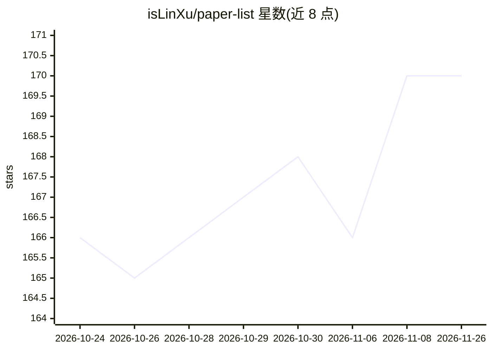

# isLinXu/paper-list

⭐ 170 · Python · Apache-2.0 · 推送 2026-11-25 · [GitHub](https://github.com/isLinXu/paper-list) · [官网](https://islinxu.github.io/paper-list/) · 个人维护

**每日自动更新按主题组织的 arXiv 论文追踪清单**

基于 GitHub Actions 的 arXiv 论文自动追踪系统，每 8 小时轮询 Papers with Code API，抓取 20+ 个计算机视觉与 AI 主题的论文，补充 arXiv 链接、翻译与代码仓库元数据后生成 Markdown 清单，同时输出 GitHub README 与 GitHub Pages 两个版本。提供趋势图表、主题排名、作者统计与代码覆盖率的分析页，关键词过滤可通过 config.yaml 自定义。以 Python 脚本运行，需 Python 3.10+。

## 筛选速览

| 维度 | 判定 | 备注 |
|---|---|---|
| AI 角色 | `ai-knowledge` | 知识聚合/清单类 |
| 许可风险 | `permissive` | Apache-2.0 |
| 部署形态 | `None` |  |
| 模型依赖 | — | README 未给出锁定关系 |
| 硬件要求 | — | 无带数字的原话,不猜 |
| 安装摩擦 | `low` | 无编译、无系统依赖或容器化 |
| 成熟度 | — | 结构信号不足 |

## 能力要点

- GitHub Actions 每 8 小时自动抓取与更新，无需人工干预
- 覆盖 20+ 个 CV/AI 研究主题，按月归档
- 自动附加 arXiv PDF、翻译、讨论与代码链接
- 提供 ?view=agent 的紧凑阅读模式与三套视觉主题

## 适用场景

- 每日跟踪计算机视觉与 AI 各方向的最新论文
- 按主题浏览并检索某月的论文归档
- 查看研究趋势、热门主题与高产作者统计

## 场景标签

`精选清单` · 领域:学习与行业

## 证据(README 行号)

> L15: **Paper-List-DAILY** is an automated arXiv paper tracking system that fetches, categorizes, and organizes the lates
> L5:  Automatically track & organize the latest arXiv papers by topic — updated daily via GitHub Actions

## 星数曲线

2026-10-24 166 → 2026-11-26 170（+4）

---
*卡片 v1 · prompt 1.4 · 生成 2026-11-26 · 置信度 high · 依据 README sha `67600c539321` · [字段定义](../../DATASET.md)*
