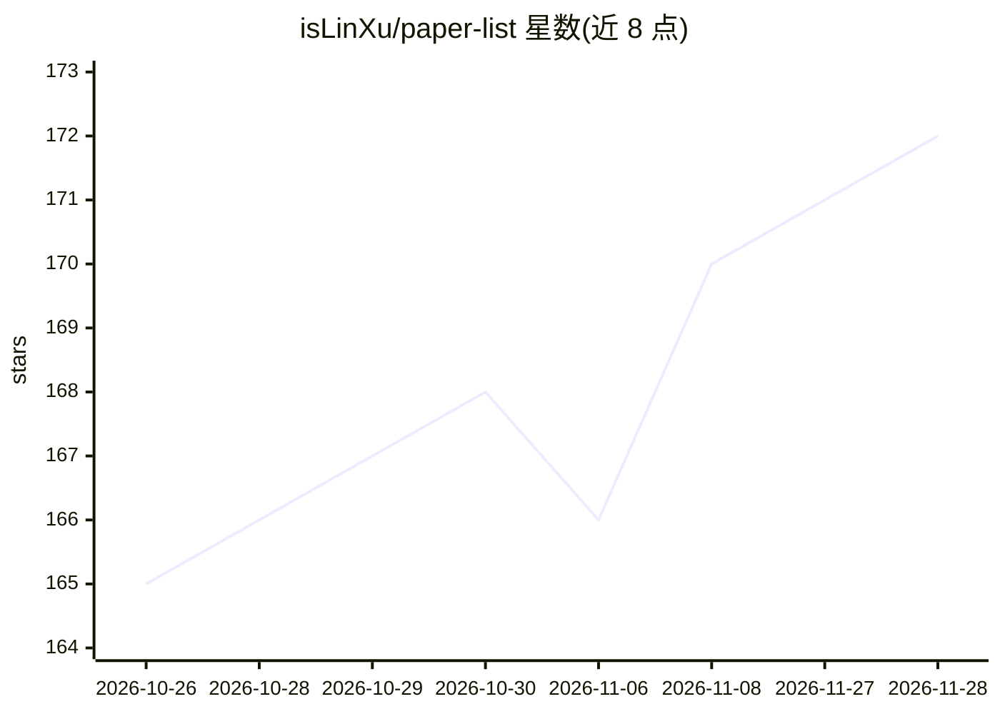

# isLinXu/paper-list

⭐ 172 · Python · Apache-2.0 · 推送 2026-11-27 · [GitHub](https://github.com/isLinXu/paper-list) · [官网](https://islinxu.github.io/paper-list/) · 个人维护

**面向研究者的 arXiv 论文每日自动追踪清单**

由 GitHub Actions 每 8 小时自动运行的工具型项目：从 Papers with Code API 拉取最新 arXiv 论文，补充 arXiv 链接、翻译链接与代码仓库链接，按 20+ 个计算机视觉与 AI 主题分类组织，生成 GitHub README 与 GitHub Pages 双输出。提供 config.yaml 自定义检索关键词、月度归档、趋势图表/主题排名/作者统计/开源代码覆盖率的分析面板，以及面向 agent 的 `?view=agent` 紧凑阅读模式。本体是论文清单与数据聚合，不产出模型输出。

## 筛选速览

| 维度 | 判定 | 备注 |
|---|---|---|
| AI 角色 | `ai-knowledge` | 知识聚合/清单类 |
| 许可风险 | `permissive` | Apache-2.0 |
| 部署形态 | `None` |  |
| 模型依赖 | — | README 未给出锁定关系 |
| 硬件要求 | — | 无带数字的原话,不猜 |
| 安装摩擦 | `low` | 无编译、无系统依赖或容器化 |
| 成熟度 | — | 结构信号不足 |

## 能力要点

- GitHub Actions 每 8 小时自动抓取与分类 arXiv 论文
- 覆盖 20+ 个 CV/AI 研究主题，按月归档
- 自动附加 arXiv PDF、翻译、讨论与代码链接
- config.yaml 自定义检索关键词与输出路径

## 适用场景

- 按主题跟踪某研究方向（如目标检测）的最新论文
- 浏览趋势图表、主题排名与高产出作者
- 通过 config.yaml 配置自己的检索关键词并 fork 部署

## 场景标签

`科研工具` · 领域:学习与行业

## 证据(README 行号)

> L5:  Automatically track & organize the latest arXiv papers by topic — updated daily via GitHub Actions
> L15: **Paper-List-DAILY** is an automated arXiv paper tracking system that fetches, categorizes, and organizes the lates
> L17: Every day, GitHub Actions automatically polls the Papers with Code API, enriches paper metadata with arXiv links, t

## 星数曲线

2026-10-26 165 → 2026-11-28 172（+7）

---
*卡片 v1 · prompt 1.4 · 生成 2026-11-27 · 置信度 high · 依据 README sha `ad2a89fabe28` · [字段定义](../../DATASET.md)*
