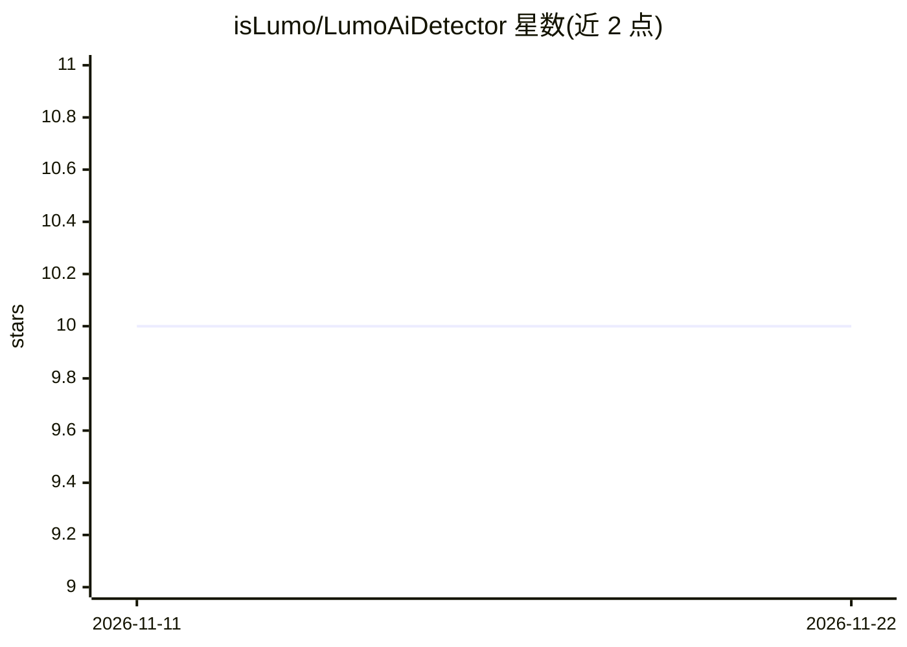

# isLumo/LumoAiDetector

⭐ — · [GitHub]() · 个人维护

**Minecraft 服务器反作弊插件：在服内训练随机森林模型检测作弊**

运行在 Bukkit/Spigot/Paper/Purpur/Folia 服务端的反作弊插件：仅采集战斗视角旋转窗口（15 tick、120 个数值特征），经战斗/目标/移动/延迟四道过滤门后记录为 CSV 数据集，在 Java 内用 Smile Random Forest 异步训练模型，服务端管理员可通过 /lad 命令管理数据集、训练、激活/对比模型，超过可疑度阈值时向管理员告警；自动惩罚默认关闭。不附带预训练模型，需服务器管理员自行录制数据训练。

## 筛选速览

| 维度 | 判定 | 备注 |
|---|---|---|
| AI 角色 | `ai-native` | 本体是模型或模型工具 |
| 许可风险 | `permissive` | — |
| 部署形态 | `desktop` | 安装包/桌面程序 |
| 模型依赖 | — | README 未给出锁定关系 |
| 硬件要求 | — | 无带数字的原话,不猜 |
| 安装摩擦 | `medium` | 含编译或系统依赖之一 |
| 成熟度 | `idea` | |

## 能力要点

- 在服务器内录制数据集并训练 Smile Random Forest 模型，无需 Python 服务
- 120 特征战斗旋转窗口与反垃圾数据过滤门
- 模型 SHA-256 完整性校验、备份恢复、对比与 RNG 种子可复现训练
- 支持 Bukkit/Spigot/Paper/Purpur/Folia，无需 NMS 或 ProtocolLib

## 适用场景

- 为自己的 Minecraft 服务器训练专属作弊检测模型
- 录制正常与作弊战斗样本构建分类数据集
- 对可疑玩家查看可疑度与告警历史

## 场景标签

`模型训练` `网络安全` · 领域:学习与行业

## 证据(README 行号)

> L22: LumoAiDetector is a free Minecraft anti-cheat that trains a local AI model inside the server. It records combat rot
> L74: - Async model training with Smile Random Forest.

## 星数曲线

2026-11-11 10 → 2026-11-22 10（+0）

---
*卡片 v1 · prompt 1.4 · 生成 2026-11-19 · 置信度 high · 依据 README sha `0dd77bb1b383` · [字段定义](../../DATASET.md)*
