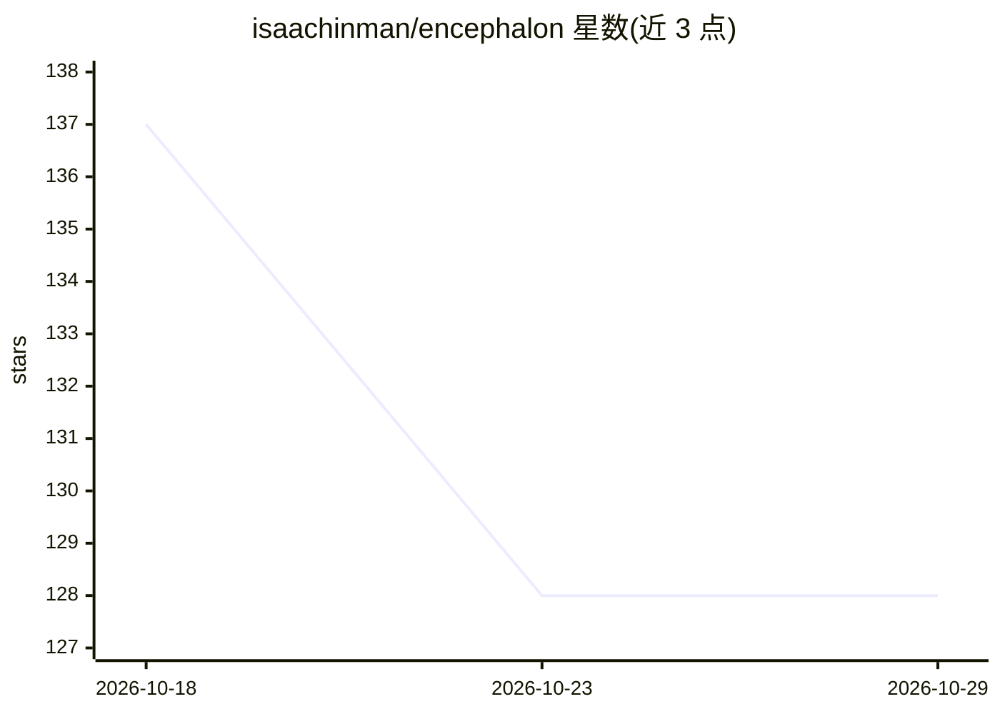

# isaachinman/encephalon

⭐ 128 · TypeScript · MIT · 推送 2026-10-26 · [GitHub](https://github.com/isaachinman/encephalon) · [官网](https://github.com/isaachinman/encephalon) · 个人维护

**给编码 agent 的仓库本地持久记忆：Git 可合并的 JSON 记录+SQLite 索引**

面向 coding agent 的仓库级知识存储：以小型 JSON 记录保存决策、架构、约定与工作流，随代码提交进 Git；用可丢弃的 SQLite 全文索引加速搜索，通过 CLI 和同步 JavaScript API 读写。记录 append-only，知识变更以 supersede 新记录表达；提供 validate/prepare/hydrate 的缓存校验与恢复机制。无账户、无托管服务、无遥测、无 embeddings，零运行时依赖。需 Node.js 24.15.0+，在仓库根安装，有记录数（1,000 条）、单条 1 MiB 等明确限额。

## 筛选速览

| 维度 | 判定 | 备注 |
|---|---|---|
| AI 角色 | `ai-ecosystem` | LLM/agent 周边工具 |
| 许可风险 | `permissive` | MIT |
| 部署形态 | `library` | 以包/库形式分发 |
| 模型依赖 | — | README 未给出锁定关系 |
| 硬件要求 | — | 无带数字的原话,不猜 |
| 安装摩擦 | `low` | 无编译、无系统依赖或容器化 |
| 成熟度 | — | 结构信号不足 |

## 能力要点

- JSON 记录随 Git 旅行，SQLite 全文索引可丢弃重建
- append-only 记录 + supersede 机制处理知识变更与冲突
- CLI 与同步 JS API，零运行时依赖、无网络访问
- validate/prepare/hydrate 缓存校验与恢复流程

## 适用场景

- 把团队决策和架构约定持久保存供 agent 检索
- 跨任务/跨分支保留项目知识与可重复工作流
- 为编码 agent 提供仓库本地的上下文记忆

## 场景标签

`Agent 记忆` · 领域:Agent 开发

## 证据(README 行号)

> L5: Encephalon gives coding agents durable, repository-local knowledge. Small JSON records travel with your code in Git;
> L7: Use it for decisions, architecture, conventions and repeatable workflows that would otherwise be lost between tasks.

## 星数曲线

2026-10-18 137 → 2026-10-29 128（-9）

---
*卡片 v1 · prompt 1.4 · 生成 2026-10-22 · 置信度 high · 依据 README sha `5d43ca4e9943` · [字段定义](../../DATASET.md)*
