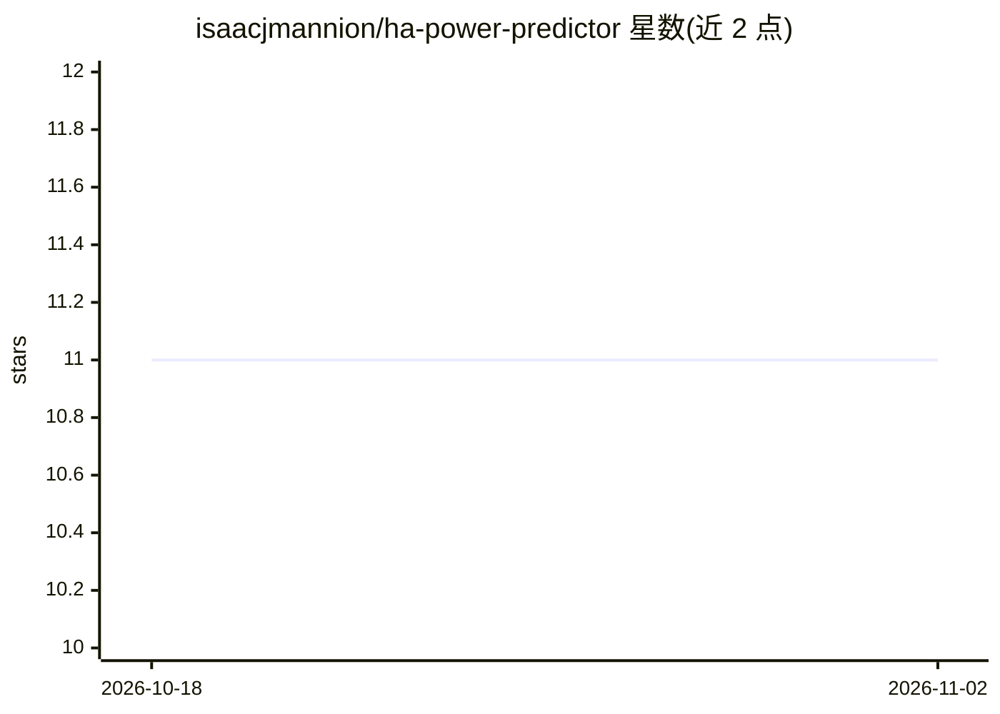

# isaacjmannion/ha-power-predictor

⭐ 11 · Python · MIT · 推送 2026-08-06 · [GitHub](https://github.com/isaacjmannion/ha-power-predictor) · 个人维护

**Home Assistant 家庭用电量预测集成：基于分位数回归的功耗预报**

Home Assistant 自定义集成，读取历史用电、室外温度与逐小时天气预报数据，用线性分位数回归模型预测未来 24–168 小时的家庭功耗，结果以 HA 传感器形式发布。支持峰/谷时段使用不同分位数、sin/cos 小时谐波特征、温度与滞后功耗特征权重调节、按小时固定 kW 偏移（如夜间 EV 充电）。提供训练数据导出按钮与离线回测/网格搜索脚本，全程 UI 配置无需 YAML。需 Home Assistant 2025.7+ 及开启长期统计的传感器。

## 筛选速览

| 维度 | 判定 | 备注 |
|---|---|---|
| AI 角色 | `ai-native` | 本体是模型或模型工具 |
| 许可风险 | `permissive` | MIT |
| 部署形态 | `desktop` | 安装包/桌面程序 |
| 模型依赖 | — | README 未给出锁定关系 |
| 硬件要求 | — | 无带数字的原话,不猜 |
| 安装摩擦 | `low` | 无编译、无系统依赖或容器化 |
| 成熟度 | — | 结构信号不足 |

## 能力要点

- 分位数回归预测未来 24/48/最长 168 小时功耗，可配置分位数
- 峰/谷时段分别设置预测分位数与时段边界
- 导出训练数据 JSON，附 tools/backtest.py 离线回测与参数网格搜索
- 发布 4 个传感器含逐小时 forecast 属性与样本内覆盖率指标

## 适用场景

- 在 Home Assistant 仪表盘中查看未来两天的家庭用电预测曲线
- 为峰谷电价家庭分别设置保守/典型预测策略
- 导出历史数据离线调参与回测，再应用回线上实例

## 场景标签

 · 领域:家庭自动化/能源

## 证据(README 行号)

> L8: Forecast future power consumption directly within Home Assistant using your historical usage and weather data.
> L12: **HA Power Predictor** is a custom Home Assistant integration that uses quantile regression to forecast future powe
> L16: - 📊 **Configurable Predictions** — Quantile regression with adjustable percentiles for conservative or typical fore

## 星数曲线

2026-10-18 11 → 2026-11-02 11（+0）

---
*卡片 v1 · prompt 1.4 · 生成 2026-11-02 · 置信度 high · 依据 README sha `afb92118d277` · [字段定义](../../DATASET.md)*
