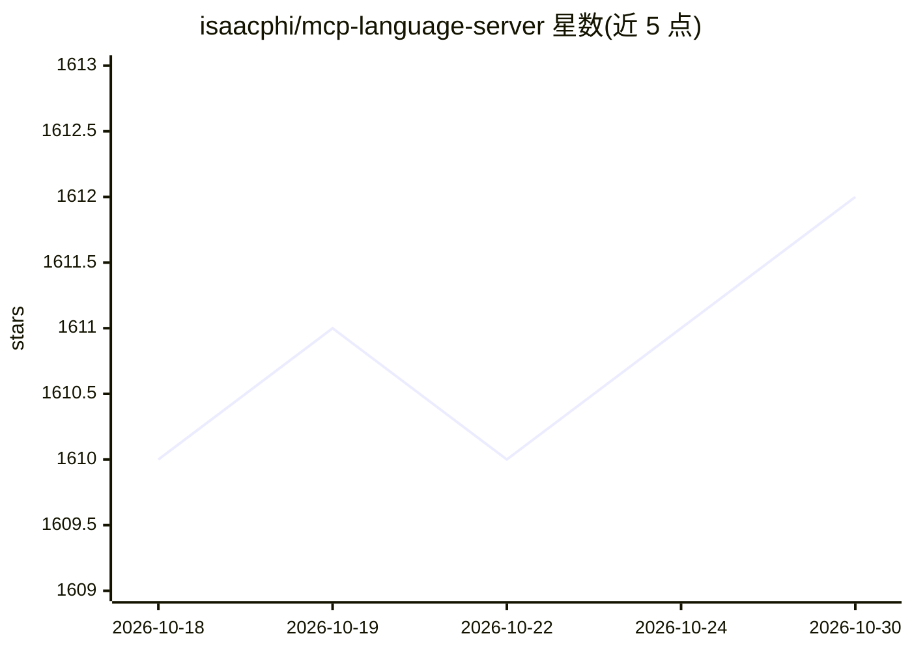

# isaacphi/mcp-language-server

⭐ 1,612 · Go · BSD-3-Clause · 推送 2026-03-01 · [GitHub](https://github.com/isaacphi/mcp-language-server) · 个人维护

**将语言服务器（LSP）能力暴露给 LLM 的 MCP 服务器**

用 Go 编写的 MCP 服务器，启动并桥接任意基于 stdio 的语言服务器（如 gopls、rust-analyzer、pyright、typescript-language-server、clangd），向 MCP 客户端（如 Claude Desktop）提供 definition、references、diagnostics、hover、rename_symbol、edit_file 等语义化代码工具，帮助 LLM 更可靠地导航和编辑代码库。通过 go install 安装，--lsp 参数指定语言服务器，作者声明仅为 beta 软件且只测试过上述几种语言服务器。

## 筛选速览

| 维度 | 判定 | 备注 |
|---|---|---|
| AI 角色 | `ai-ecosystem` | LLM/agent 周边工具 |
| 许可风险 | `permissive` | BSD-3-Clause |
| 部署形态 | `desktop` | 安装包/桌面程序 |
| 模型依赖 | — | README 未给出锁定关系 |
| 硬件要求 | — | 无带数字的原话,不猜 |
| 安装摩擦 | `low` | 无编译、无系统依赖或容器化 |
| 成熟度 | `idea` | |

## 能力要点

- 提供 definition/references/diagnostics/hover/rename/edit_file 六个工具
- 支持任意基于 stdio 的语言服务器（gopls、rust-analyzer、pyright 等）
- edit_file 基于行号做多处文本编辑，替代搜索替换式编辑

## 适用场景

- 让 AI 编码助手基于 LSP 精确定位符号定义与引用
- 在 Claude Desktop 等 MCP 客户端中对项目做跨文件重命名
- 获取文件的诊断信息辅助 AI 修错

## 场景标签

`编码 Agent` · 领域:编码与开发

## 证据(README 行号)

> L8: This is an MCP server that runs and exposes a language server to LLMs. Not a language server for MCP, whatever that 
> L12: `mcp-language-server` helps MCP enabled clients navigate codebases more easily by giving them access semantic tools

## 星数曲线

2026-10-18 1,610 → 2026-10-30 1,612（+2）

---
*卡片 v1 · prompt 1.4 · 生成 2026-10-21 · 置信度 mid · 依据 README sha `f7546aec276d` · [字段定义](../../DATASET.md)*
