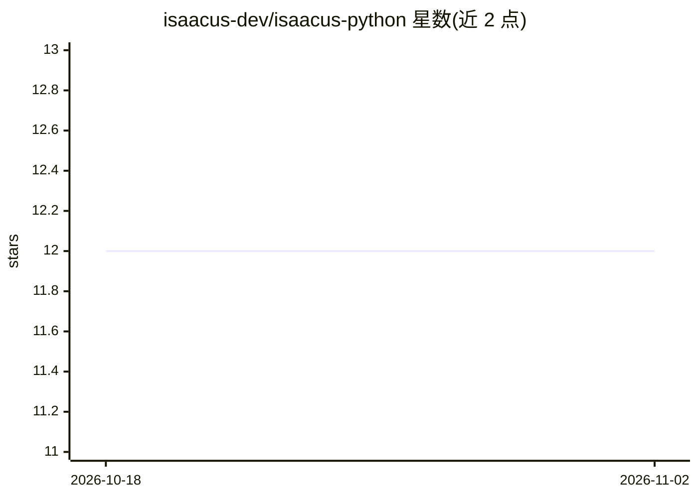

# isaacus-dev/isaacus-python

⭐ 12 · Python · Apache-2.0 · 推送 2026-08-23 · [GitHub](https://github.com/isaacus-dev/isaacus-python) · [官网](https://docs.isaacus.com) · 组织维护

**面向 Isaacus 法律 AI API 的 Python SDK，供开发者接入**

由 Stainless 生成的 Isaacus REST API 官方 Python 客户端库，支持 Python 3.9+，提供同步与异步（AsyncIsaacus）两种客户端，默认基于 httpx，可选用 aiohttp 后端。包含全部请求参数与响应字段的类型定义（TypedDict/Pydantic 模型），内置自动重试（默认 2 次）、超时配置、流式响应、未文档化端点访问等能力。另提供 MCP Server，使 AI 助手（如 Cursor、VS Code 中的客户端）能探索端点并调用该 API。使用需 Isaacus API Key。Isaacus 主题涉及法律/NLP 领域。

## 筛选速览

| 维度 | 判定 | 备注 |
|---|---|---|
| AI 角色 | `ai-ecosystem` | LLM/agent 周边工具 |
| 许可风险 | `permissive` | Apache-2.0 |
| 部署形态 | `library` | 以包/库形式分发 |
| 模型依赖 | — | README 未给出锁定关系 |
| 硬件要求 | — | 无带数字的原话,不猜 |
| 安装摩擦 | `low` | 无编译、无系统依赖或容器化 |
| 成熟度 | — | 结构信号不足 |

## 能力要点

- 同步与异步双客户端，默认 httpx、可选 aiohttp 后端
- 全量类型定义（TypedDict 请求 + Pydantic 响应模型）
- 内置自动重试（默认 2 次、指数退避）与超时、流式响应支持
- 附带 MCP Server，供 AI 助手探索端点与调试集成

## 适用场景

- 在 Python 应用中调用 Isaacus 法律 NLP API
- 通过异步客户端做高并发 API 请求
- 在 Cursor/VS Code 中通过 MCP 让 AI 助手协助接入该 SDK

## 场景标签

 · 领域:法律 AI/NLP API 客户端

## 证据(README 行号)

> L5: The Isaacus Python library provides convenient access to the Isaacus REST API from any Python 3.9+
> L13: Use the Isaacus MCP Server to enable AI assistants to interact with this API, allowing them to explore endpoints, m

## 星数曲线

2026-10-18 12 → 2026-11-02 12（+0）

---
*卡片 v1 · prompt 1.4 · 生成 2026-11-01 · 置信度 high · 依据 README sha `878b4493c066` · [字段定义](../../DATASET.md)*
