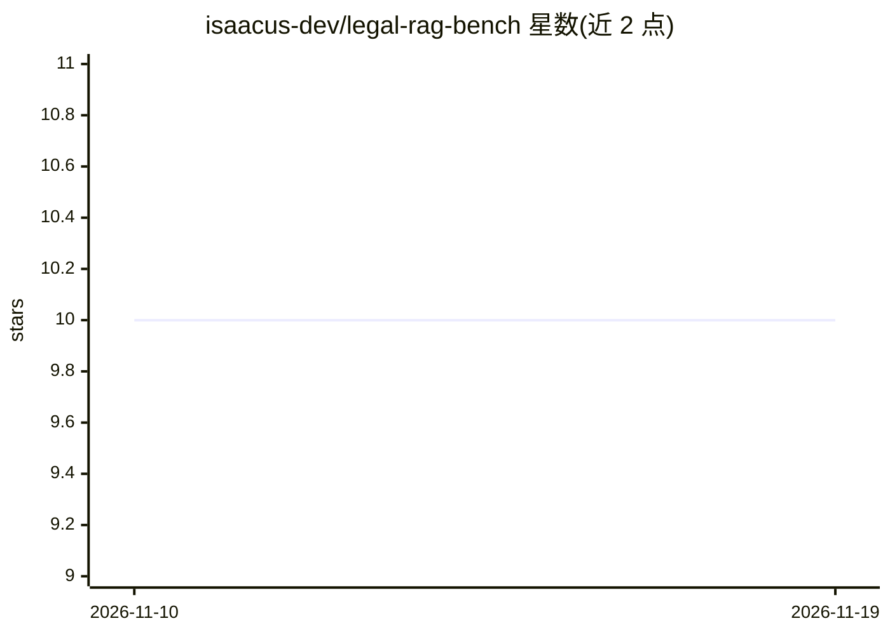

# isaacus-dev/legal-rag-bench

⭐ 10 · Python · MIT · 推送 2026-03-03 · [GitHub](https://github.com/isaacus-dev/legal-rag-bench) · 组织维护

**法律领域 RAG 系统端到端评测基准及其评估代码**

该仓库包含用于在 Legal RAG Bench 上评测法律 RAG 系统的代码。默认配置评测 6 种 RAG 管线组合（3 个嵌入模型 × 2 个生成模型），以 GPT-5.2 作为 judge LLM 从正确性与接地性两方面判定，输出 JSONL 结果文件，含每题的 RAG 回答、人工标注答案、检索文档与 judge 评估。基准数据存放于另一仓库；通过 config.py 与 prompts.py 可自定义模型、检索深度 k 与提示词。README 说明结果因 LLM 非确定性、供应商模型更新、依赖变化等因素不可完全复现。MIT 许可。

## 筛选速览

| 维度 | 判定 | 备注 |
|---|---|---|
| AI 角色 | `ai-ecosystem` | LLM/agent 周边工具 |
| 许可风险 | `permissive` | MIT |
| 部署形态 | `library` | 以包/库形式分发 |
| 模型依赖 | — | README 未给出锁定关系 |
| 硬件要求 | — | 无带数字的原话,不猜 |
| 安装摩擦 | `low` | 无编译、无系统依赖或容器化 |
| 成熟度 | — | 结构信号不足 |

## 能力要点

- 默认评测 3 个嵌入模型 × 2 个生成模型共 6 种管线组合，检索 k=5
- judge LLM 按 correct/grounded 两维度判定并给出 reasoning 解释
- 通过 config.py 的 LangChain 集成自定义嵌入、生成与 judge 模型
- 可调整检索深度 Ks 列表与生成/judge 提示词

## 适用场景

- 评估法律问答 RAG 系统的端到端检索与生成效果
- 对比不同嵌入模型在法律语料检索中的表现
- 按 correct/grounded 指标核查生成回答的接地性

## 场景标签

`模型评测` · 领域:评测与运维

## 证据(README 行号)

> L3: This repository contains the code used to evaluate RAG systems on Legal RAG Bench.
> L28: The default configuration evaluates **n = 6** RAG pipeline permutations:

## 星数曲线

2026-11-10 10 → 2026-11-19 10（+0）

---
*卡片 v1 · prompt 1.4 · 生成 2026-11-19 · 置信度 high · 依据 README sha `fb91587a5e0c` · [字段定义](../../DATASET.md)*
