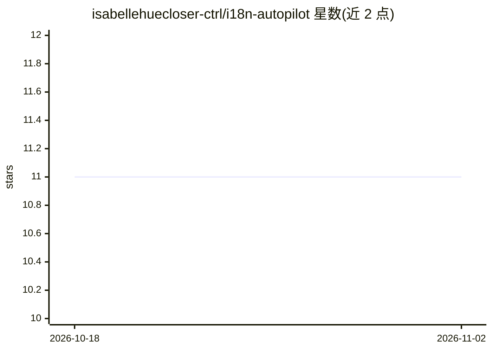

# isabellehuecloser-ctrl/i18n-autopilot

⭐ 11 · TypeScript · MIT · 推送 2026-06-22 · [GitHub](https://github.com/isabellehuecloser-ctrl/i18n-autopilot) · [官网](https://i18n.useautopilot.dev) · 个人维护

**自动翻译 PR 中缺失 i18n 键的 GitHub Action**

在每次 pull request 上运行的 GitHub Action：读取源语言 locale 文件，检测其他语言中缺失或为空的键，调用 OpenAI 模型（默认 gpt-4o-mini）翻译并保留占位符与 HTML，随后提交回 PR 分支并发布摘要评论。自动检测平铺与嵌套目录布局。面向维护多语言 Web 项目的开发者；提供免费 Action（自带 API key）与私有仓库需付费 license key 的 Pro 形态，另有免配置的 Hosted Pro 应用。数据仅经过用户自选的 AI 提供商。

## 筛选速览

| 维度 | 判定 | 备注 |
|---|---|---|
| AI 角色 | `ai-native` | 本体是模型或模型工具 |
| 许可风险 | `permissive` | MIT |
| 部署形态 | `None` |  |
| 模型依赖 | — | README 未给出锁定关系 |
| 硬件要求 | — | 无带数字的原话,不猜 |
| 安装摩擦 | `low` | 无编译、无系统依赖或容器化 |
| 成熟度 | — | 结构信号不足 |

## 能力要点

- PR 中自动检测并翻译各 locale 缺失或为空的键
- 保留 {name}/{{count}}/%s/:id 等占位符与 HTML 标签
- 自动检测 flat 与 nested 两种 locale 目录布局
- license 服务器不可达时检查 fails open，不阻塞 CI

## 适用场景

- 提交 PR 后自动补齐新增文案的各语言翻译
- 维护 react-i18next 等嵌套命名空间的多语言项目
- 免去手工向每个 locale 文件复制新键值

## 场景标签

 · 领域:开发工具/国际化

## 证据(README 行号)

> L6: **Auto-translate your missing i18n keys on every pull request — powered by AI.**
> L10: every other locale, translates it, and commits the result back to the PR with a
> L91: 3. Translates only those values, preserving placeholders (`{name}`, `{{count}}`,

## 星数曲线

2026-10-18 11 → 2026-11-02 11（+0）

---
*卡片 v1 · prompt 1.4 · 生成 2026-11-02 · 置信度 high · 依据 README sha `c8694c91e333` · [字段定义](../../DATASET.md)*
