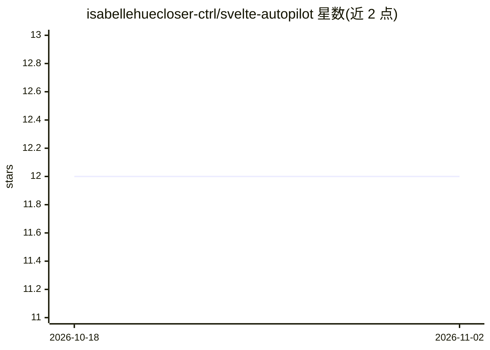

# isabellehuecloser-ctrl/svelte-autopilot

⭐ 12 · TypeScript · MIT · 推送 2026-06-22 · [GitHub](https://github.com/isabellehuecloser-ctrl/svelte-autopilot) · [官网](https://svelte.useautopilot.dev) · 个人维护

**面向 Svelte 5/SvelteKit 的 AI PR 代码审查 GitHub Action**

以 GitHub Action 形式运行的代码审查工具：读取 PR 的变更文件与 diff（经 GitHub API，无需 checkout），过滤出 Svelte/SvelteKit 源文件后，将 diff 连同 Svelte 5 专用审查提示词发送给 OpenAI 模型（默认 gpt-4o，自带 API key），在 PR 上发布并持续更新一条分组审查评论。检测项覆盖 runes/响应性误用、SvelteKit 密钥泄漏与 SSR 崩溃风险、XSS 与可访问性问题。公开仓库免费，私有仓库需付费 license key（$19/月）。

## 筛选速览

| 维度 | 判定 | 备注 |
|---|---|---|
| AI 角色 | `ai-ecosystem` | LLM/agent 周边工具 |
| 许可风险 | `permissive` | MIT |
| 部署形态 | `None` |  |
| 模型依赖 | — | README 未给出锁定关系 |
| 硬件要求 | — | 无带数字的原话,不猜 |
| 安装摩擦 | `low` | 无编译、无系统依赖或容器化 |
| 成熟度 | — | 结构信号不足 |

## 能力要点

- 读取 PR diff 并以 Svelte 5 专用提示词调用 OpenAI 模型生成审查
- 检测 runes/响应性、SvelteKit 密钥泄漏、SSR 崩溃、XSS/a11y 等问题
- 无需 checkout，diff 通过 GitHub API 读取，发布单条持续更新的分组评论
- 可配置审查模型、文件类型过滤与每次审查的最大文件数（默认 20）

## 适用场景

- SvelteKit 项目在 PR 中自动发现密钥泄漏与 SSR 崩溃风险
- 团队为 Svelte 5 代码审查响应式 API 的误用
- 在 PR 流程中加入针对 Svelte 的 AI 审查而不引入额外服务端

## 场景标签

`代码审查` · 领域:编码与开发

## 证据(README 行号)

> L6: **AI code review specialized for Svelte 5 & SvelteKit — on every pull request.**
> L88: 3. Sends the diffs to an LLM with a Svelte-5-specialized reviewer prompt.

## 星数曲线

2026-10-18 12 → 2026-11-02 12（+0）

---
*卡片 v1 · prompt 1.4 · 生成 2026-11-01 · 置信度 high · 依据 README sha `396d80c26bb3` · [字段定义](../../DATASET.md)*
