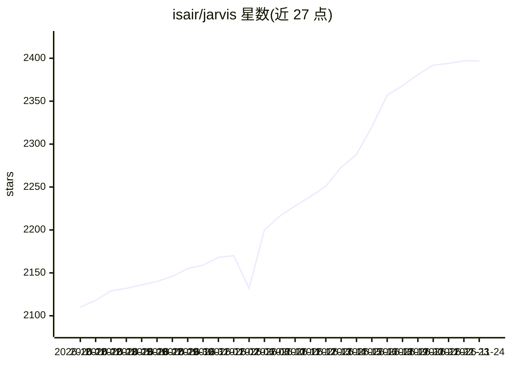

# isair/jarvis

⭐ 2,397 · Python · NOASSERTION · 推送 2026-11-19 · [GitHub](https://github.com/isair/jarvis) · [官网](https://barissencan.com/jarvis/) · 个人维护

**本地优先的桌面 AI 语音助手，语音/文字对话**

面向桌面用户的本地 AI 助手：语音与文字对话、语音听写输入、本地日记与知识图谱记忆、截图 OCR、营养追踪等内置工具，并支持通过 MCP 服务器接入浏览器自动化、智能家居等外部工具。语音识别、语言模型与语音合成均可在用户自有硬件上本地运行，安装向导引导选择模型服务器，敏感信息在进入模型上下文前做脱敏处理。macOS 开发为主，Windows/Linux 行为可能不同；Linux 听写需 X11。

## 筛选速览

| 维度 | 判定 | 备注 |
|---|---|---|
| AI 角色 | `ai-native` | 本体是模型或模型工具 |
| 许可风险 | `none` | NOASSERTION |
| 部署形态 | `desktop` | 安装包/桌面程序 |
| 模型依赖 | local-ok | 支持本地模型 |
| 硬件要求 | — | 无带数字的原话,不猜 |
| 安装摩擦 | `low` | 无编译、无系统依赖或容器化 |
| 成熟度 | — | 结构信号不足 |

## 能力要点

- 语音优先对话：名字唤醒并结合近期对话上下文参与讨论
- 支持 Ollama 或 OpenAI 兼容本地模型服务器（LM Studio、oMLX、llama.cpp）
- MCP 服务器接入自定义工具，支持无限记忆与自学习
- 本地听写：按住快捷键说话、松开粘贴转写文本

## 适用场景

- 在桌面端进行完全本地化的语音 AI 对话
- 通过语音听写向任意应用输入转写文本
- 让助手记住并查询历史对话、偏好与计划
- 接入 MCP 服务器控制智能家居或浏览器

## 场景标签

`语音 Agent` `AI 助手` `语音识别` `OCR` · 领域:对话与助手

## 证据(README 行号)

> L5: A private, local-first AI assistant with voice and text chat.
> L16: Address Jarvis by name anywhere in a sentence and follow up naturally. Speech recognition, language models and spee
> L35: **2. Choose your local models.** The setup wizard guides you through speech recognition and a model server. Use Oll

## 星数曲线

2026-10-21 2,110 → 2026-11-24 2,397（+287）

---
*卡片 v1 · prompt 1.4 · 生成 2026-11-23 · 置信度 high · 依据 README sha `3569952e2777` · [字段定义](../../DATASET.md)*
