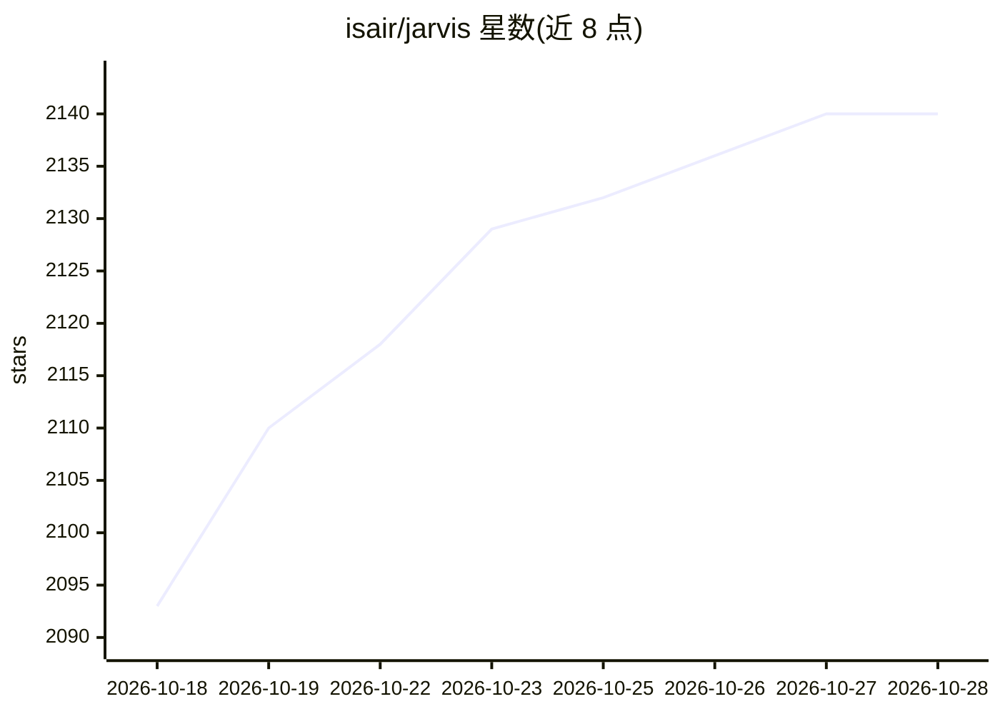

# isair/jarvis

⭐ 2,146 · Python · NOASSERTION · 推送 2026-10-20 · [GitHub](https://github.com/isair/jarvis) · [官网](https://barissencan.com/jarvis/) · 个人维护

**桌面端私有本地 AI 语音/文字助手，带个人记忆与 MCP 工具**

跨平台（macOS/Windows/Linux）桌面 AI 助手应用：语音与文字聊天、本地听写、个人记忆（日记与知识图谱存储在本机）、内置网页搜索/天气/OCR/营养追踪等工具，并可通过 MCP 接入浏览器自动化、Home Assistant 等外部工具。语音识别、语言模型与语音合成默认本地运行，使用 Ollama 或任意 OpenAI 兼容服务端（LM Studio/llama.cpp 等）。主要在 macOS 上开发，Windows/Linux 行为可能有差异；macOS 26+ 听写不可用，无移动端。

## 筛选速览

| 维度 | 判定 | 备注 |
|---|---|---|
| AI 角色 | `ai-native` | 本体是模型或模型工具 |
| 许可风险 | `none` | NOASSERTION |
| 部署形态 | `desktop` | 安装包/桌面程序 |
| 模型依赖 | local-ok | 支持本地模型 |
| 硬件要求 | — | 无带数字的原话,不猜 |
| 安装摩擦 | `low` | 无编译、无系统依赖或容器化 |
| 成熟度 | — | 结构信号不足 |

## 能力要点

- 语音优先交互：按名唤起、加入现场对话并利用滚动转写上下文
- 本地个人记忆（日记+知识图），敏感信息在进入模型上下文或存档前被脱敏
- MCP 工具接入：浏览器自动化、Home Assistant、GitHub、数据库等
- 全局热键听写到其他应用，配合任务中心本地排队执行

## 适用场景

- 在桌面用语音或文字与本地 AI 助手对话讨论想法
- 让助手记住跨会话的偏好、计划与过往对话
- 通过 MCP 把浏览器自动化、智能家居等工具接入助手

## 场景标签

`AI 助手` `语音 Agent` `Agent 记忆` · 领域:Agent 开发

## 证据(README 行号)

> L5: A private, local-first AI assistant with voice and text chat.
> L16: Address Jarvis by name anywhere in a sentence and follow up naturally. Speech recognition, language models and spee
> L18: Your diary and knowledge graph stay on your computer. Speech and chat models run locally when you use a local model

## 星数曲线

2026-10-18 2,093 → 2026-10-28 2,140（+47）

---
*卡片 v1 · prompt 1.4 · 生成 2026-10-21 · 置信度 high · 依据 README sha `f0fec813aec7` · [字段定义](../../DATASET.md)*
