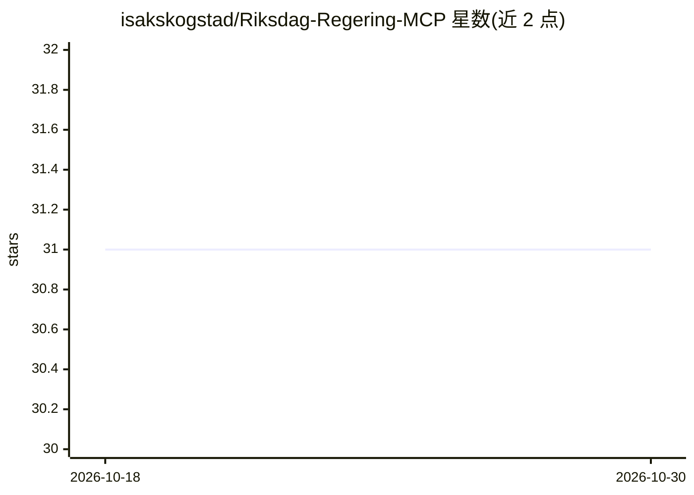

# isakskogstad/Riksdag-Regering-MCP

⭐ 31 · TypeScript · 推送 2026-05-07 · [GitHub](https://github.com/isakskogstad/Riksdag-Regering-MCP) · [官网](https://github.com/KSAklfszf921/Riksdag-Regering-MCP) · 个人维护

**为 LLM 提供瑞典议会与政府开放数据访问的 MCP 服务器**

开源 MCP 服务器，支持本地自托管，供 LLM 查询瑞典议会（Riksdagen）与政府办公厅（Regeringskansliet）的实时开放数据、文档、议事记录等。暴露 32 个专用工具，覆盖议员信息、议会文件、发言记录、投票记录与政府文件；数据源为 data.riksdagen.se 官方开放 API 与 g0v.se。提供 npm（npx）与源码两种安装方式，运行环境为 Node.js 20+（TypeScript、Express、MCP SDK）。

## 筛选速览

| 维度 | 判定 | 备注 |
|---|---|---|
| AI 角色 | `ai-ecosystem` | LLM/agent 周边工具 |
| 许可风险 | `permissive` | — |
| 部署形态 | `None` |  |
| 模型依赖 | — | README 未给出锁定关系 |
| 硬件要求 | — | 无带数字的原话,不猜 |
| 安装摩擦 | `low` | 无编译、无系统依赖或容器化 |
| 成熟度 | — | 结构信号不足 |

## 能力要点

- 32 个专用工具覆盖议员、议会文件、发言、投票、政府文件
- 接入 Riksdagen 官方开放 API 与 g0v.se 数据
- 支持 npm/npx 与源码两种安装方式，本地自托管

## 适用场景

- 让 Claude 等 LLM 客户端直接查询瑞典议会投票与议员活动
- 交叉检索议会与政府文件（议案、SOU、质询等）
- 做议会活动的时间序列与政党投票模式分析

## 场景标签

`数据分析` · 领域:效率与自动化

## 证据(README 行号)

> L9: 🇺🇸 Open-source MCP-server for local self-hosting. Enables LLMs to query and retrieve real-time open data, documents,
> L17: MCP-servern exponerar 32 specialiserade verktyg för att hämta data och underlag, som exempelvis:

## 星数曲线

2026-10-18 31 → 2026-10-30 31（+0）

---
*卡片 v1 · prompt 1.4 · 生成 2026-10-26 · 置信度 high · 依据 README sha `8a26c5562bba` · [字段定义](../../DATASET.md)*
