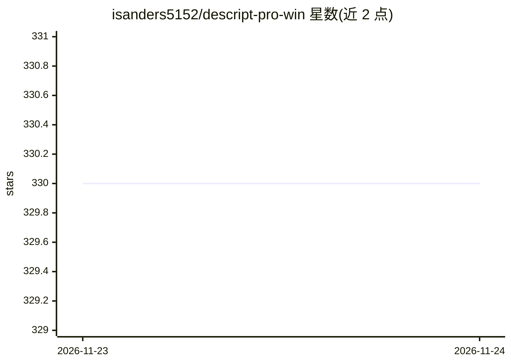

# isanders5152/descript-pro-win

⭐ 330 · NOASSERTION · 推送 2026-11-21 · [GitHub](https://github.com/isanders5152/descript-pro-win) · [官网](https://isanders5152.github.io/descript-pro-win/) · 个人维护

**面向 Windows 创作者的 Descript Pro 文本化音视频编辑器使用指南**

这是一个 Windows 10/11 平台的 Descript Pro 参考与设置指南：介绍基于文本编辑的音视频/播客编辑流程，覆盖录制、自动转录、删改文字即剪辑媒体、多轨合成与导出发布。面向播客、教程、社交媒体内容的初学者与专业创作者。给出系统需求（x64、8GB 内存、DirectX 11 等）、安装步骤、兼容性与常见问题；本身不含下载链接与许可证信息，需从官方渠道获取安装包。

## 筛选速览

| 维度 | 判定 | 备注 |
|---|---|---|
| AI 角色 | `ai-enhanced` | 去掉 AI 部分产品仍成立 |
| 许可风险 | `none` | NOASSERTION |
| 部署形态 | `None` |  |
| 模型依赖 | — | README 未给出锁定关系 |
| 硬件要求 | — | 无带数字的原话,不猜 |
| 安装摩擦 | `low` | 无编译、无系统依赖或容器化 |
| 成熟度 | — | 结构信号不足 |

## 能力要点

- 通过编辑转录文本完成音视频剪辑（删除/重排词语即剪切媒体）
- 自动转录、屏幕/摄像头录制、一键音频清理与填充词删除
- Overdub：输入文本生成用户本人音色的语音修补
- 给出 x64 架构、内存、存储与 DirectX 11 等运行依赖

## 适用场景

- 剪辑播客和教程视频，通过改文字完成删减
- 录制屏幕演示并自动生成字幕与文稿
- 给访谈和课程视频做快速音频清理

## 场景标签

`教程课程` · 领域:学习与行业

## 证据(README 行号)

> L1: Descript Pro: AI-Powered Text-Based Video and Podcast Editor for Windows
> L19: Descript Pro is an AI-powered video and podcast editor that lets you edit audio and video by editing text, much lik
> L36: |**Dependencies**|DirectX 11 or later, updated graphics drivers, Windows Media Foundation codecs, and Visual C++ Re

## 星数曲线

2026-11-23 330 → 2026-11-24 330（+0）

---
*卡片 v1 · prompt 1.4 · 生成 2026-11-23 · 置信度 high · 依据 README sha `561831fc868d` · [字段定义](../../DATASET.md)*
