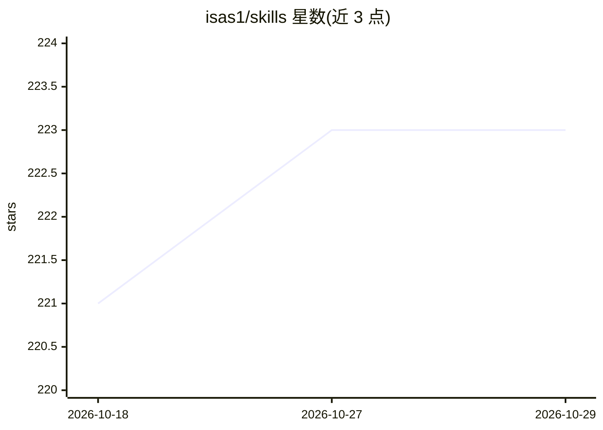

# isas1/skills

⭐ 223 · MIT · 推送 2026-09-26 · [GitHub](https://github.com/isas1/skills) · 个人维护

**两个 Claude 技能：聊天内白话解释与生成单页 HTML 摘要**

面向 Claude 用户的一对 SKILL 格式技能：eli5-succinct 在聊天中输出简短白话解释（不产生文件），summary 读取 git 状态、日志与变更文件后生成单个自包含 HTML 摘要页，无构建步骤、无 CDN 依赖，可导出 PDF。summary 支持三种可叠加模式（无障碍/艺术/动画），其中无障碍模式冲突时优先。README 同时提供免安装的提示词替代方案。安装方式为复制目录到 ~/.claude/skills/，两个技能需同时安装以完成路由。

## 筛选速览

| 维度 | 判定 | 备注 |
|---|---|---|
| AI 角色 | `ai-native` | 本体是模型或模型工具 |
| 许可风险 | `permissive` | MIT |
| 部署形态 | `None` |  |
| 模型依赖 | — | README 未给出锁定关系 |
| 硬件要求 | — | 无带数字的原话,不猜 |
| 安装摩擦 | `low` | 无编译、无系统依赖或容器化 |
| 成熟度 | — | 结构信号不足 |

## 能力要点

- eli5-succinct 在聊天内输出简短白话解释，不产生文件
- summary 读取 git status/log/diff 实际内容生成自包含 HTML 单页
- 三种模式：无障碍（ADHD/autistic/dyslexia）、艺术、动画
- 提供免安装的聊天提示词替代方案

## 适用场景

- 让 Claude 把复杂内容用白话在聊天里简短解释
- 把一次会话或 git 分支工作生成可分享的 HTML 摘要页
- 生成对注意力/阅读障碍用户更友好的无障碍摘要

## 场景标签

`提示工程` · 领域:Agent 开发

## 证据(README 行号)

> L3: Two skills for explaining and summarising work. They route on **what you want to end up holding**, not on which word
> L73: cp -r skills/eli5-succinct ~/.claude/skills/

## 星数曲线

2026-10-18 221 → 2026-10-29 223（+2）

---
*卡片 v1 · prompt 1.4 · 生成 2026-10-22 · 置信度 high · 依据 README sha `4283439124d2` · [字段定义](../../DATASET.md)*
