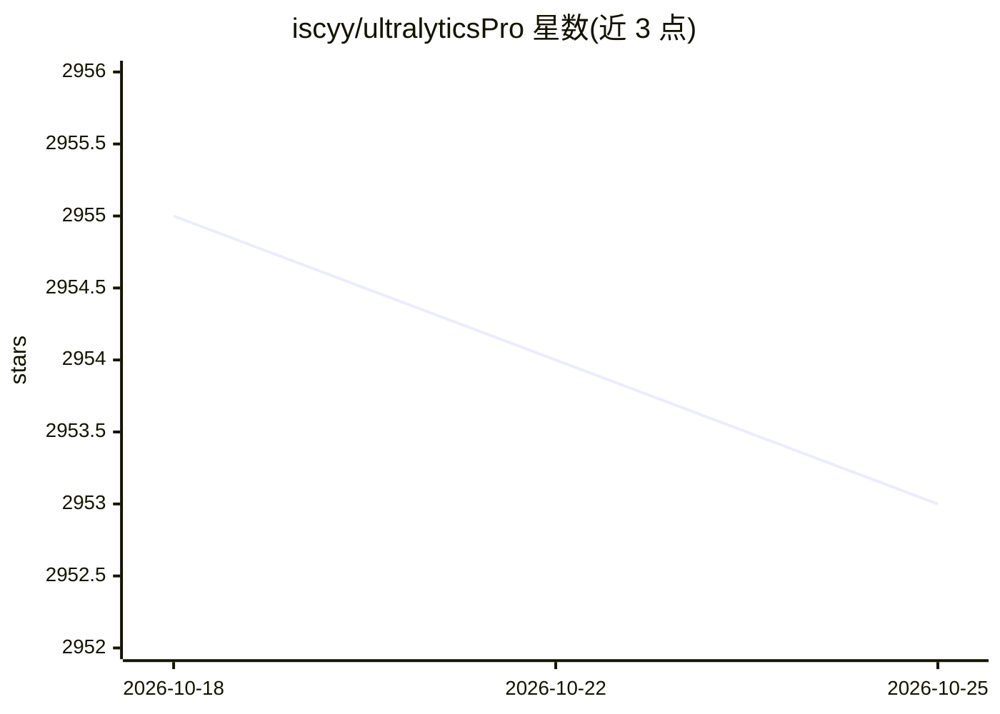

# iscyy/ultralyticsPro

⭐ 2,953 · Python · 推送 2025-12-15 · [GitHub](https://github.com/iscyy/ultralyticsPro) · [官网](https://github.com/iscyy/ultralyticsPro) · 个人维护 · 中文 README

**YOLO 系列目标检测模型的改进版集合与模块库**

基于 ultralytics YOLO 系列的改进项目，覆盖 YOLO11、YOLOv8、YOLOv10、RT-DETR、YOLOv7、YOLOv5 等模型，支持对 backbone、neck、head、loss、IoU、NMS 等模块进行替换与改进，供需要调整检测模型结构的开发者和研究者使用。README 仅展示项目定位与更新说明，未给出安装命令、依赖或使用示例；具体改进点内容需查看仓库内其他文件。

## 筛选速览

| 维度 | 判定 | 备注 |
|---|---|---|
| AI 角色 | `ai-native` | 本体是模型或模型工具 |
| 许可风险 | `none` | — |
| 部署形态 | `None` |  |
| 模型依赖 | — | README 未给出锁定关系 |
| 硬件要求 | — | 无带数字的原话,不猜 |
| 安装摩擦 | `low` | 无编译、无系统依赖或容器化 |
| 成熟度 | — | 结构信号不足 |

## 能力要点

- 覆盖 YOLO11/v8/v10/v7/v5 与 RT-DETR 等多个检测模型
- 支持改进 backbone、neck、head、loss、IoU、NMS 等模块

## 适用场景

- 为目标检测任务替换或改进 YOLO 模型结构组件
- 尝试不同 backbone/loss/IoU 改进组合进行实验

## 场景标签

`目标检测` · 领域:感知与多模态

## 证据(README 行号)

> L1: 🔥🔥🔥 专注于YOLO11，YOLOv8、YOLOv10、RT-DETR、YOLOv7、YOLOv5改进模型，Support to improve backbone, neck, head, loss, IoU, NMS and o
> L5: 🌟 全新的YOLO系列改进项目 **ultralyticsPro**，最新改进点更新🚀

## 星数曲线

2026-10-18 2,955 → 2026-10-25 2,953（-2）

---
*卡片 v1 · prompt 1.4 · 生成 2026-10-20 · 置信度 low · 依据 README sha `1d36dce13e67` · [字段定义](../../DATASET.md)*
