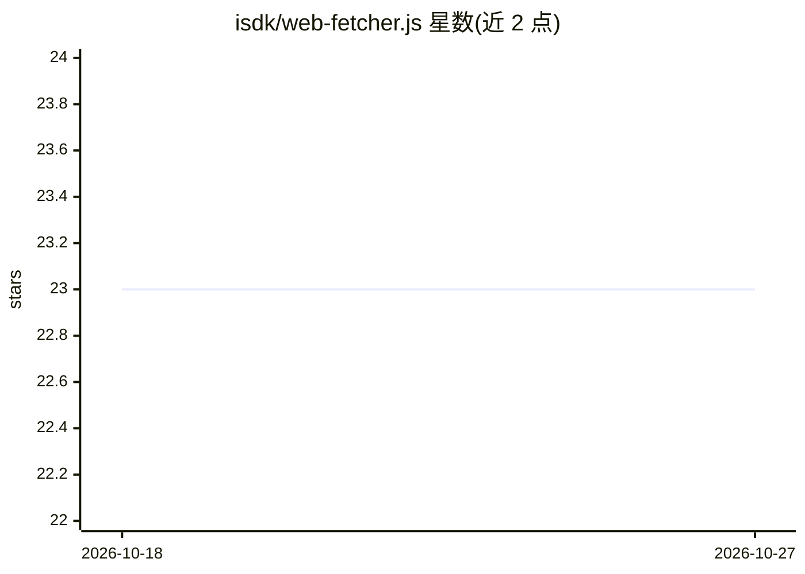

# isdk/web-fetcher.js

⭐ 23 · HTML · MIT · 推送 2026-09-29 · [GitHub](https://github.com/isdk/web-fetcher.js) · 组织维护 · 中文 README

**供 AI agent 用的声明式网页自动化库，双引擎抓取与反检测**

面向 AI agent 的 Node/TypeScript 网页交互库：以声明式 JSON 动作脚本定义登录、填表、点击等多步流程，统一 API 下可在 http 模式（Cheerio）与 browser 模式（Playwright）间切换；enableSmart 可根据状态码或 JS 渲染特征自动升级引擎并同步会话状态。browser 模式提供可选 antibot 标志（camoufox 隐身 Firefox、Cloudflare 挑战处理）及贝塞尔鼠标轨迹、拟真打字延迟等交互模拟。定位为任务导向的数据提取，非全站爬虫构建。npm 安装，browser 模式需另行下载 Playwright 浏览器二进制。

## 筛选速览

| 维度 | 判定 | 备注 |
|---|---|---|
| AI 角色 | `ai-ecosystem` | LLM/agent 周边工具 |
| 许可风险 | `permissive` | MIT |
| 部署形态 | `library` | 以包/库形式分发 |
| 模型依赖 | — | README 未给出锁定关系 |
| 硬件要求 | — | 无带数字的原话,不猜 |
| 安装摩擦 | `low` | 无编译、无系统依赖或容器化 |
| 成熟度 | — | 结构信号不足 |

## 能力要点

- 声明式 JSON 动作脚本定义多步网页工作流
- http（Cheerio）/browser（Playwright）双引擎统一 API，支持自动升级与重试策略
- antibot 标志：camoufox 隐身 Firefox 与 Cloudflare 挑战处理
- 声明式 Schema 提取嵌套结构化数据，支持自定义复合动作

## 适用场景

- 让 AI agent 以 JSON 脚本执行登录、填表、点击等网页操作
- 静态/动态站点通用的任务式数据提取
- 应对 Cloudflare 等反爬检测的浏览器自动化

## 场景标签

`浏览器自动化` `网页抓取` · 领域:效率与自动化

## 证据(README 行号)

> L13: > An AI-friendly web automation library that simplifies complex web interactions into a declarative JSON action scr
> L17: * **⚙️ Dual-Engine Architecture**: Choose between **`http`** mode (powered by Cheerio) for speed on static sites, o

## 星数曲线

2026-10-18 23 → 2026-10-27 23（+0）

---
*卡片 v1 · prompt 1.4 · 生成 2026-10-27 · 置信度 high · 依据 README sha `0b2cc74a22df` · [字段定义](../../DATASET.md)*
