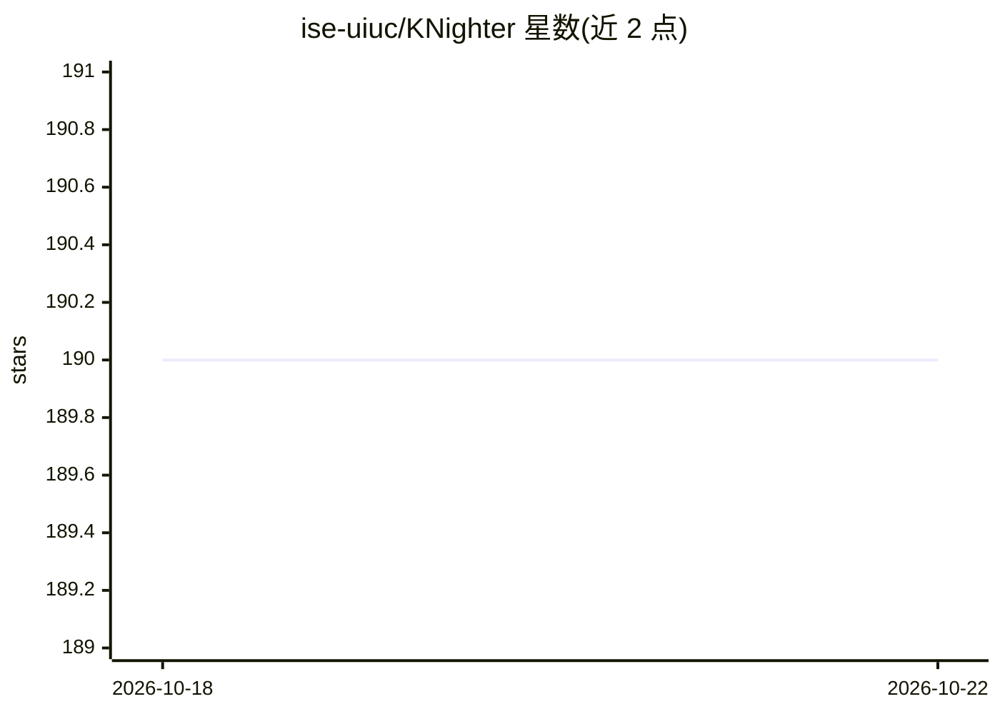

# ise-uiuc/KNighter

⭐ 190 · C++ · Apache-2.0 · 推送 2025-10-26 · [GitHub](https://github.com/ise-uiuc/KNighter) · 组织维护

**用 LLM 从历史补丁自动合成 Linux 内核静态分析检查器**

面向系统级静态分析的检查器自动合成工具：从历史 patch commit 中提取 bug 模式，经 LLM 生成 LLVM 静态分析检查器，再通过编译测试进行 refine，最后用 triage 模式扫描内核并对结果分类。提供 gen/refine/scan/triage 四种运行模式，支持 OpenAI、Anthropic、Google 等多种模型密钥配置。推荐以 Docker 镜像运行，首次启动需下载并编译 LLVM 与 Linux 内核源码；也可手动安装 LLVM-18.1.8。发表于 SOSP'25，由高校研究团队维护。

## 筛选速览

| 维度 | 判定 | 备注 |
|---|---|---|
| AI 角色 | `ai-ecosystem` | LLM/agent 周边工具 |
| 许可风险 | `permissive` | Apache-2.0 |
| 部署形态 | `self-host` | docker 或自建部署 |
| 模型依赖 | — | README 未给出锁定关系 |
| 硬件要求 | — | 无带数字的原话,不猜 |
| 安装摩擦 | `low` | 无编译、无系统依赖或容器化 |
| 成熟度 | — | 结构信号不足 |

## 能力要点

- 从历史 patch commit 学习并提取 bug 模式
- LLM 生成 → refine → triage 多步流水线合成检查器
- 基于 LLVM 构建，面向 Linux 内核等大规模 C/C++ 代码库
- 提供 Docker 镜像与 gen/refine/scan/triage 四种运行模式

## 适用场景

- 自动生成针对 Linux 内核 bug 模式的静态分析检查器
- 用已验证的检查器扫描大规模 C/C++ 代码库并对结果分类
- 基于历史补丁研究系统级静态分析检查器的自动化合成

## 场景标签

`代码审查` `科研工具` · 领域:编码与开发

## 证据(README 行号)

> L11: **KNighter** is an innovative checker synthesis tool that leverages Large Language Models (LLMs) to automatically g
> L18: - **⚡ LLVM Integration**: Built on top of LLVM for robust static analysis capabilities

## 星数曲线

2026-10-18 190 → 2026-10-22 190（+0）

---
*卡片 v1 · prompt 1.4 · 生成 2026-10-22 · 置信度 high · 依据 README sha `7a71b67d46ac` · [字段定义](../../DATASET.md)*
