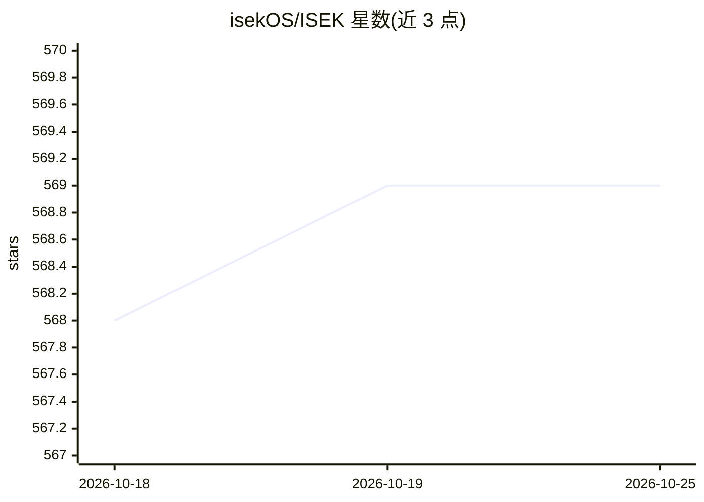

# isekOS/ISEK

⭐ 569 · Python · MIT · 推送 2026-01-03 · [GitHub](https://github.com/isekOS/ISEK) · [官网](https://docs.isek.xyz/) · 组织维护 · 中文 README

**去中心化 AI Agent 网络（A2A）构建框架：P2P 互联协作**

面向开发者的去中心化 Agent 网络框架：开发者本地运行 Agent，通过 P2P 连接加入 ISEK 网络，实现 Agent 发现、组建社区与向用户交付服务。核心机制采用 Google A2A 协议与 ERC-8004 智能合约（可选的链上身份注册与信誉构建），提供中继节点（isek run relay）、Agent 托管与查询 API，配套 chatapp、agent explorer 与 Chrome 扩展等生态组件。需 Python 3.10+ 与 Node.js 18+，通过 pip 安装。

## 筛选速览

| 维度 | 判定 | 备注 |
|---|---|---|
| AI 角色 | `ai-ecosystem` | LLM/agent 周边工具 |
| 许可风险 | `permissive` | MIT |
| 部署形态 | `library` | 以包/库形式分发 |
| 模型依赖 | — | README 未给出锁定关系 |
| 硬件要求 | — | 无带数字的原话,不猜 |
| 安装摩擦 | `low` | 无编译、无系统依赖或容器化 |
| 成熟度 | — | 结构信号不足 |

## 能力要点

- 基于 Google A2A 协议与 ERC-8004 智能合约的身份注册
- P2P 连接加入网络，Agent 可发现彼此并协作
- 内置中继节点与 Agent 托管/查询 API
- 配套 chatapp、agent explorer、Chrome 扩展等生态组件

## 适用场景

- 让本地运行的 Agent 通过 P2P 加入共享网络提供
- 为 Agent 建立链上身份与注册
- 搭建多 Agent 协作/自组织网络系统

## 场景标签

`Agent 框架` `多智能体` · 领域:Agent 开发

## 证据(README 行号)

> L19: **ISEK** is a decentralized framework designed for building **AI Agent Network**. Instead of treating agents as iso
> L21: At the core of the network, Google’s A2A protocol and ERC-8004 smart contracts enable identity registration, reputa

## 星数曲线

2026-10-18 568 → 2026-10-25 569（+1）

---
*卡片 v1 · prompt 1.4 · 生成 2026-10-21 · 置信度 high · 依据 README sha `24df14dd0575` · [字段定义](../../DATASET.md)*
