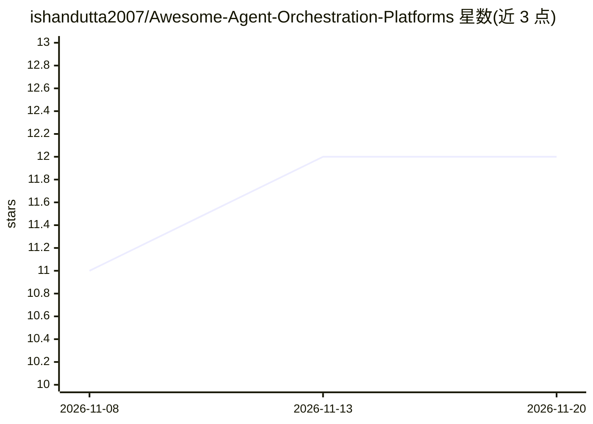

# ishandutta2007/Awesome-Agent-Orchestration-Platforms

⭐ 12 · MIT · 推送 2026-11-07 · [GitHub](https://github.com/ishandutta2007/Awesome-Agent-Orchestration-Platforms) · 个人维护

**多智能体编排框架与平台的策展清单**

按 Claude 与 LLM 生态组织的 Multi-Agent 系统、Agentic 工作流与编排框架清单，分 SaaS 托管平台、确定性高控制编排、角色型多智能体框架、厂商 SDK、工具组件五个板块收录，每条附一句话描述与 GitHub 链接；另含市场概况、2026 趋势、按目标推荐工具的对比表与术语说明，接受社区通过 CONTRIBUTING.md 提交条目。

## 筛选速览

| 维度 | 判定 | 备注 |
|---|---|---|
| AI 角色 | `ai-knowledge` | 知识聚合/清单类 |
| 许可风险 | `permissive` | MIT |
| 部署形态 | `None` |  |
| 模型依赖 | — | README 未给出锁定关系 |
| 硬件要求 | — | 无带数字的原话,不猜 |
| 安装摩擦 | `low` | 无编译、无系统依赖或容器化 |
| 成熟度 | — | 结构信号不足 |

## 能力要点

- 五个板块收录 SaaS 平台、编排框架、SDK 与工具组件
- 对比表按生产可靠性、可视化设计等目标推荐工具
- 覆盖 MCP、Agentic RAG、Agent FinOps 等 2026 趋势条目

## 适用场景

- 为构建多智能体系统选型编排框架
- 了解 Agent 平台与工具生态的收录情况
- 按开发场景（RAG、原型验证、TS 集成）查找推荐工具

## 场景标签

`精选清单` · 领域:学习与行业

## 证据(README 行号)

> L9: **A curated list of Multi-Agent Systems (MAS), Agentic Workflows, and Orchestration Frameworks for the Claude & LLM 
> L142: 3. Ensure it includes a 1-sentence description and a link.

## 星数曲线

2026-11-08 11 → 2026-11-20 12（+1）

---
*卡片 v1 · prompt 1.4 · 生成 2026-11-18 · 置信度 high · 依据 README sha `7a31e4d1cf18` · [字段定义](../../DATASET.md)*
