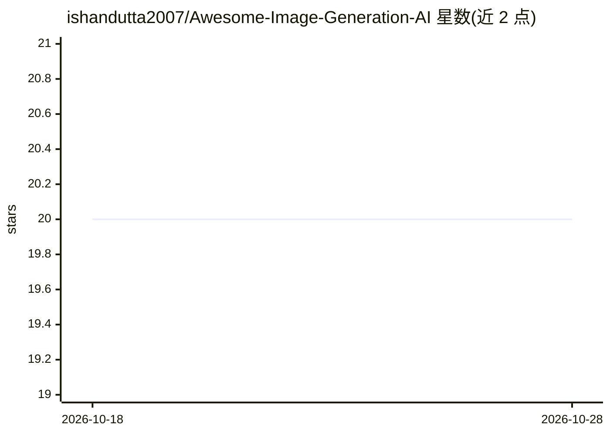

# ishandutta2007/Awesome-Image-Generation-AI

⭐ 20 · MIT · 推送 2026-09-09 · [GitHub](https://github.com/ishandutta2007/Awesome-Image-Generation-AI) · 个人维护

**AI 图像生成工具策展清单：收录 SaaS 平台与开源项目**

由个人维护的 Awesome 类型策展清单，收录 AI 图像生成领域的 SaaS 产品（含公司规模、定价、免费额度）与开源 GitHub 项目（Stable Diffusion WebUI、ComfyUI、Fooocus 等）。主题聚焦 Text-to-Image、Image-to-Image、生成式 AI 艺术与本地 Stable Diffusion/Flux 部署，覆盖 LoRA、ControlNet 等技术。声明为社区维护、非穷尽、非背书，通过 Fork+PR 方式贡献条目。面向设计师、艺术家、营销人员与开发者。

## 筛选速览

| 维度 | 判定 | 备注 |
|---|---|---|
| AI 角色 | `ai-knowledge` | 知识聚合/清单类 |
| 许可风险 | `permissive` | MIT |
| 部署形态 | `None` |  |
| 模型依赖 | — | README 未给出锁定关系 |
| 硬件要求 | — | 无带数字的原话,不猜 |
| 安装摩擦 | `low` | 无编译、无系统依赖或容器化 |
| 成熟度 | — | 结构信号不足 |

## 能力要点

- SaaS 条目附公司规模、定价与免费额度信息
- 开源项目按专用生成工具与补充选项分组收录
- 覆盖从提示词生成图到 LoRA/ControlNet 等控制技术
- 通过 Fork 修改 README 并提交 PR 的贡献流程

## 适用场景

- 对比各 AI 图像生成 SaaS 的定价与免费额度
- 查找本地自托管的 Stable Diffusion/Flux 工具
- 了解图像生成领域的开源项目分布

## 场景标签

`精选清单` · 领域:学习与行业

## 证据(README 行号)

> L18: > 🚀 **The definitive curated list of AI Image Generation Tools, SaaS platforms, and Open-Source projects.** ✨
> L23: This repository tracks notable **SaaS platforms** and **open-source projects** building **AI image generation tools
> L109: - This is a **community-curated** list — not exhaustive and not an endorsement.

## 星数曲线

2026-10-18 20 → 2026-10-28 20（+0）

---
*卡片 v1 · prompt 1.4 · 生成 2026-10-28 · 置信度 high · 依据 README sha `b00584c99586` · [字段定义](../../DATASET.md)*
