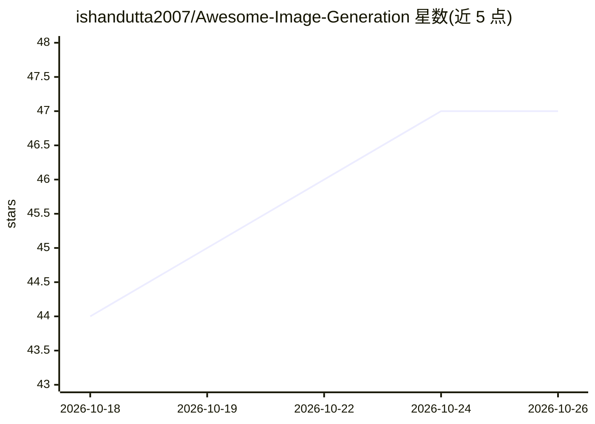

# ishandutta2007/Awesome-Image-Generation

⭐ 47 · MIT · 推送 2026-08-21 · [GitHub](https://github.com/ishandutta2007/Awesome-Image-Generation) · 个人维护

**图像生成 AI 模型与工具的策展清单（awesome list）**

由个人维护的图像生成领域策展仓库：汇总云 SaaS 产品（含定价与免费额度）、开源 GitHub 项目、SOTA 模型对比表（年份/权重/论文/许可证）、工具与平台、2024-2026 新闻、社区入口与研究资源，覆盖 Stable Diffusion、FLUX.1、Midjourney、DALL-E 等。面向研究者、开发者与 AI 创作者做选型与追踪参考；条目以表格列举为主，不提供安装运行方式，接受 PR 贡献与捐赠。

## 筛选速览

| 维度 | 判定 | 备注 |
|---|---|---|
| AI 角色 | `ai-knowledge` | 知识聚合/清单类 |
| 许可风险 | `permissive` | MIT |
| 部署形态 | `None` |  |
| 模型依赖 | — | README 未给出锁定关系 |
| 硬件要求 | — | 无带数字的原话,不猜 |
| 安装摩擦 | `low` | 无编译、无系统依赖或容器化 |
| 成熟度 | — | 结构信号不足 |

## 能力要点

- 云 SaaS 产品表含定价、免费额度与公司规模
- SOTA 模型对比表覆盖年份/权重可用性/论文/许可证（2017-2026）
- 收录开源仓库、工具平台、社区与论文浏览入口

## 适用场景

- 选型时对比图像生成模型与 SaaS 产品的定价和许可证
- 追踪 2024-2026 图像生成领域的发布动态
- 查找开源图像生成仓库与研究入口

## 场景标签

`精选清单` · 领域:学习与行业

## 证据(README 行号)

> L15: Welcome to the **Image Generation Landscape**—a comprehensive, curated repository of **State-of-the-Art (SOTA) Imag
> L43: |Model Name|Year|Pretrained Weights|Codebase|Research Paper|Quality|License|

## 星数曲线

2026-10-18 44 → 2026-10-26 47（+3）

---
*卡片 v1 · prompt 1.4 · 生成 2026-10-25 · 置信度 high · 依据 README sha `82413dab8ab7` · [字段定义](../../DATASET.md)*
