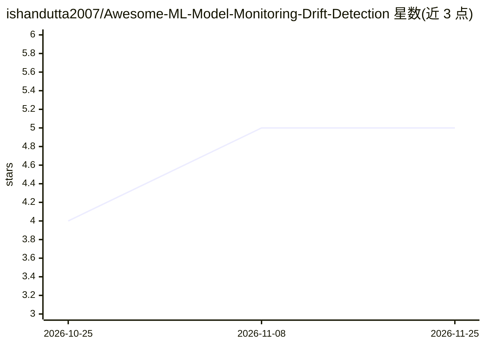

# ishandutta2007/Awesome-ML-Model-Monitoring-Drift-Detection

⭐ 5 · MIT · 推送 2026-11-04 · [GitHub](https://github.com/ishandutta2007/Awesome-ML-Model-Monitoring-Drift-Detection) · 个人维护

**给 MLOps 工程师的模型监控与漂移检测资源清单**

社区维护的精选清单，索引 ML 模型监控、AI 可观测性与数据漂移检测领域的 SaaS 平台与开源框架。内容分企业 SaaS 对比矩阵（按估值排序，含定价与免费额度）与按 Star 数排序的开源项目排名（含许可证、领域、差异化特性）。覆盖数据漂移、概念漂移、无真值性能估计、LLM 追踪与护栏观测等主题，另含市场规模与行业格局章节。无安装或运行内容，仅链接索引。

## 筛选速览

| 维度 | 判定 | 备注 |
|---|---|---|
| AI 角色 | `ai-knowledge` | 知识聚合/清单类 |
| 许可风险 | `permissive` | MIT |
| 部署形态 | `None` |  |
| 模型依赖 | — | README 未给出锁定关系 |
| 硬件要求 | — | 无带数字的原话,不猜 |
| 安装摩擦 | `low` | 无编译、无系统依赖或容器化 |
| 成熟度 | — | 结构信号不足 |

## 能力要点

- 企业 SaaS 平台对比矩阵，含估值、定价与免费额度
- 11+ 开源框架按 Star 数排名，标注许可证与核心差异
- 覆盖数据漂移、概念漂移、LLM 追踪与护栏观测四类需求

## 适用场景

- 为生产 ML 系统选型漂移检测工具
- 对比各家监控 SaaS 的定价与免费额度
- 查找可私有化部署的开源可观测性框架

## 场景标签

`精选清单` `MLOps` · 领域:学习与行业

## 证据(README 行号)

> L3: # 🚀 Awesome ML Model Monitoring & Drift Detection
> L13: This repository systematically indexes the top **SaaS platforms** and **open-source frameworks** tailored for produ
> L85: ## 💻 Open-Source GitHub Projects

## 星数曲线

2026-10-25 4 → 2026-11-25 5（+1）

---
*卡片 v1 · prompt 1.4 · 生成 2026-11-21 · 置信度 high · 依据 README sha `1d89271e8070` · [字段定义](../../DATASET.md)*
