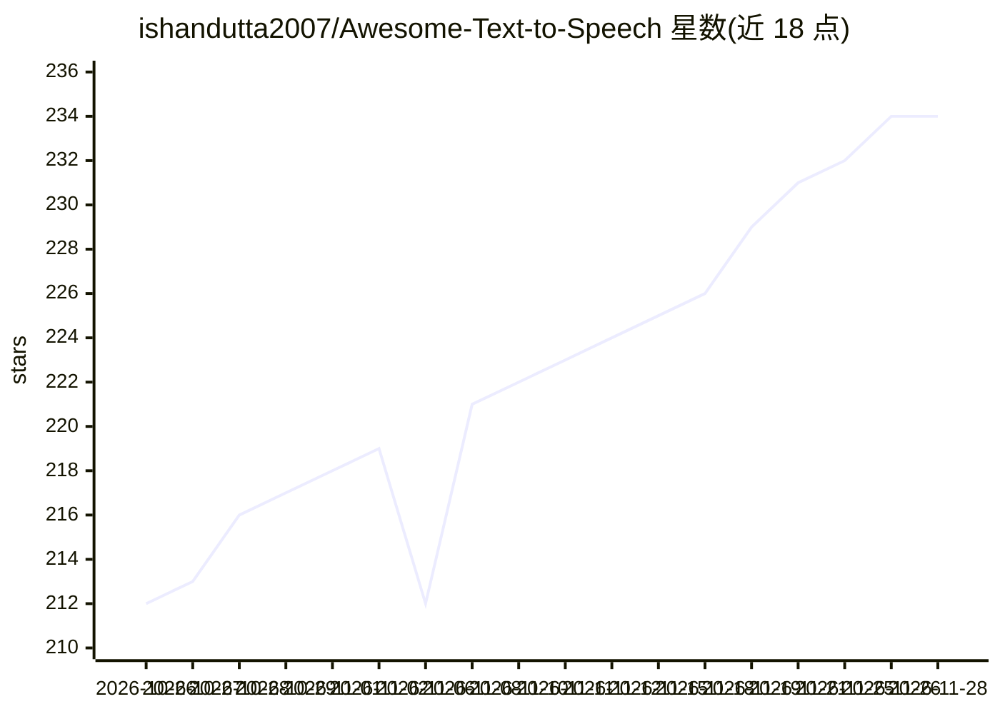

# ishandutta2007/Awesome-Text-to-Speech

⭐ 234 · MIT · 推送 2026-11-07 · [GitHub](https://github.com/ishandutta2007/Awesome-Text-to-Speech) · 个人维护

**面向 TTS 使用者的模型与工具策展清单（云服务+开源项目）**

收录 Text-to-Speech 领域工具、模型与资源的策展清单，分为商业云平台与开源/本地项目两部分，以表格列出服务/模型、所属组织、关键特性、定价或语言与仓库链接。云平台部分按公司规模排序，开源部分按 GitHub Stars 排序，覆盖语音克隆、多语言、CPU 运行、实时低延迟等类别条目。清单面向寻找 TTS 模型或 API 的用户，通过 PR 接受社区贡献，不含自身安装或运行说明。

## 筛选速览

| 维度 | 判定 | 备注 |
|---|---|---|
| AI 角色 | `ai-knowledge` | 知识聚合/清单类 |
| 许可风险 | `permissive` | MIT |
| 部署形态 | `None` |  |
| 模型依赖 | — | README 未给出锁定关系 |
| 硬件要求 | — | 无带数字的原话,不猜 |
| 安装摩擦 | `low` | 无编译、无系统依赖或容器化 |
| 成熟度 | — | 结构信号不足 |

## 能力要点

- 商业 TTS 平台表格：收录 20 余项服务并标注定价与组织信息
- 开源 TTS 项目表格：收录 25+ 项目并标注语言与仓库链接
- 涵盖语音克隆、低延迟实时 TTS、CPU 端运行、浏览器内运行等条目

## 适用场景

- 为 AI Agent 或应用挑选 TTS API 服务
- 寻找可本地运行或商用许可的开源 TTS 模型
- 对比各开源项目支持的语言与语音克隆能力

## 场景标签

`语音合成` `精选清单` · 领域:内容生成

## 证据(README 行号)

> L3: # Awesome Text-to-Speech (TTS) 🗣️: Best AI Voice Generation Models & Tools 2026
> L48: ## 📚 Comprehensive List of Text-to-Speech (TTS) Resources 🌐
> L76: ### 🏗️ Open-Source Text-to-Speech Libraries & Local-First Projects

## 星数曲线

2026-10-26 212 → 2026-11-28 234（+22）

---
*卡片 v1 · prompt 1.4 · 生成 2026-11-25 · 置信度 high · 依据 README sha `58cffdf6f0ac` · [字段定义](../../DATASET.md)*
