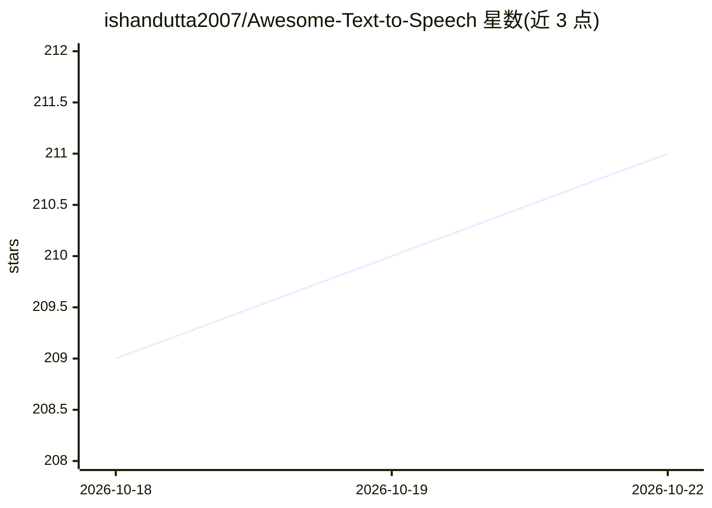

# ishandutta2007/Awesome-Text-to-Speech

⭐ 211 · MIT · 推送 2026-10-13 · [GitHub](https://github.com/ishandutta2007/Awesome-Text-to-Speech) · 个人维护

**语音合成（TTS）模型与服务策展清单，面向开发者选型**

持续维护的 Text-to-Speech 资源聚合清单：按云端商业平台（含订阅价格与公司规模）和开源/本地优先项目（按 GitHub 星数排序）两大板块组织，收录 NVIDIA NeMo、Azure、ElevenLabs、Coqui TTS、GPT-SoVITS、Piper、sherpa-onnx 等条目，每条列出关键特性、语言栈与链接。面向需要挑选 TTS 方案的开发者与内容创作者，覆盖语音克隆、低延迟实时合成、多语言、CPU 本地运行等主题。本体为清单仓库，不提供可运行代码。

## 筛选速览

| 维度 | 判定 | 备注 |
|---|---|---|
| AI 角色 | `ai-knowledge` | 知识聚合/清单类 |
| 许可风险 | `permissive` | MIT |
| 部署形态 | `None` |  |
| 模型依赖 | — | README 未给出锁定关系 |
| 硬件要求 | — | 无带数字的原话,不猜 |
| 安装摩擦 | `low` | 无编译、无系统依赖或容器化 |
| 成熟度 | — | 结构信号不足 |

## 能力要点

- 云端商业 TTS 平台对照表（含最低订阅价与公司规模）
- 开源 TTS 库列表按 GitHub 星数排序并标注关键特性
- 覆盖语音克隆、低延迟实时合成、CPU 本地运行等主题

## 适用场景

- 为应用挑选云端或本地 TTS 服务
- 对比各 TTS 平台的定价与特性
- 寻找可本地运行、支持语音克隆的开源模型

## 场景标签

 · 领域:语音合成/知识聚合

## 证据(README 行号)

> L3: # Awesome Text-to-Speech (TTS) 🗣️: Best AI Voice Generation Models & Tools 2026
> L48: ## 📚 Comprehensive List of Text-to-Speech (TTS) Resources 🌐
> L85: ### 🏗️ Open-Source Text-to-Speech Libraries & Local-First Projects

## 星数曲线

2026-10-18 209 → 2026-10-22 211（+2）

---
*卡片 v1 · prompt 1.4 · 生成 2026-10-22 · 置信度 high · 依据 README sha `9b89de8530f0` · [字段定义](../../DATASET.md)*
