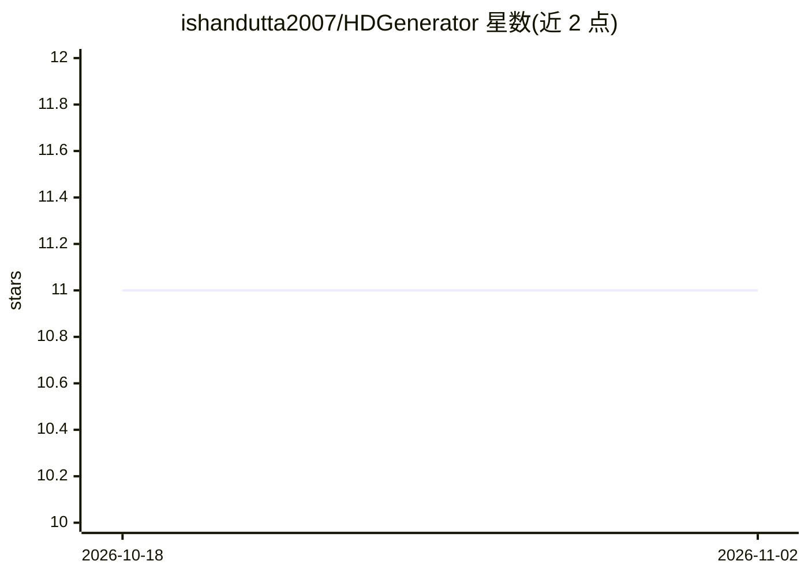

# ishandutta2007/HDGenerator

⭐ 11 · Python · MIT · 推送 2026-08-31 · [GitHub](https://github.com/ishandutta2007/HDGenerator) · 个人维护

**本地将 SD 视频 4x 超分升清的 CLI 工具**

基于 Python 的命令行视频超分工具：用 OpenCV 逐帧解码，经 ONNX Runtime 运行 RealESR_Gx4_fp16（Real-ESRGAN）模型做 4x 空间超分，再重新编码输出 HD/4K 视频。全部处理在本地运行，不上传云端。支持 MP4/AVI/MOV/MKV 等输入格式，支持 CPU 与 GPU（CUDA/DirectML）推理，GPU 需另行安装 onnxruntime-gpu 并配置 CUDA/cuDNN。模型权重需从 Hugging Face 手动下载放入 models/ 目录。通过 git clone 源码并 pip 安装依赖运行。

## 筛选速览

| 维度 | 判定 | 备注 |
|---|---|---|
| AI 角色 | `ai-native` | 本体是模型或模型工具 |
| 许可风险 | `permissive` | MIT |
| 部署形态 | `library` | 以包/库形式分发 |
| 模型依赖 | — | README 未给出锁定关系 |
| 硬件要求 | — | 无带数字的原话,不猜 |
| 安装摩擦 | `medium` | 含编译或系统依赖之一 |
| 成熟度 | — | 结构信号不足 |

## 能力要点

- Real-ESRGAN（RealESR_Gx4_fp16）ONNX 模型实现 4x 视频超分
- ONNX Runtime 推理，支持 CPU 与 GPU（CUDA/DirectML）
- 处理全程本地运行，不上传云端
- CLI 提供输入、输出与自定义模型路径参数

## 适用场景

- 把老家庭视频或低分辨率片段升清到 HD/4K
- 本地离线批量增强视频画质，不依赖云服务
- 在自定义管线中集成视频超分处理

## 场景标签

`图像视频处理` · 领域:感知与多模态

## 证据(README 行号)

> L14: > 🌟 **HD Video Generator** is an open-source, lightweight, and high-performance command-line (CLI) tool to upscale 
> L26: * 🤖 **AI-Powered 4x Video Upscaling:** Harnesses the deep learning power of Real-ESRGAN (`RealESR_Gx4_fp16`) to rec

## 星数曲线

2026-10-18 11 → 2026-11-02 11（+0）

---
*卡片 v1 · prompt 1.4 · 生成 2026-11-02 · 置信度 high · 依据 README sha `ac3f086749cc` · [字段定义](../../DATASET.md)*
