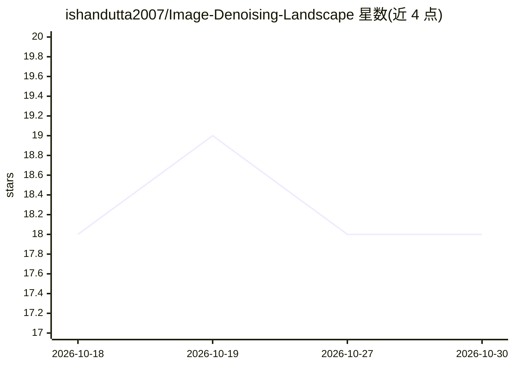

# ishandutta2007/Image-Denoising-Landscape

⭐ 18 · MIT · 推送 2026-09-01 · [GitHub](https://github.com/ishandutta2007/Image-Denoising-Landscape) · 个人维护

**图像去噪研究/模型/数据集/工具的策展清单**

一个 awesome 类的策展仓库：以表格形式收录图像去噪领域的深度学习与 Transformer 架构（Restormer、NAFNet、SwinIR、InstructIR 等）、自监督/零样本方法、扩散生成模型、基准数据集（SIDD、DND、BSDS500 等）、评估指标、经典算法（BM3D、NLM 等）、SaaS 在线去噪工具与教程综述，条目附代码与论文链接。面向计算机视觉研究者与工程师选型参考，本身不含可运行代码。

## 筛选速览

| 维度 | 判定 | 备注 |
|---|---|---|
| AI 角色 | `ai-knowledge` | 知识聚合/清单类 |
| 许可风险 | `permissive` | MIT |
| 部署形态 | `library` | 以包/库形式分发 |
| 模型依赖 | — | README 未给出锁定关系 |
| 硬件要求 | — | 无带数字的原话,不猜 |
| 安装摩擦 | `low` | 无编译、无系统依赖或容器化 |
| 成熟度 | — | 结构信号不足 |

## 能力要点

- 按方法范式分类收录 SOTA 去噪模型条目并附代码/论文链接
- 收录 6 个基准数据集与 PSNR/SSIM/LPIPS 等评估指标说明
- 汇总 7 款 SaaS 在线去噪工具的免费额度与定价信息
- 覆盖经典算法（BM3D/NLM/WNNM/TV）与教程综述资源

## 适用场景

- 为去噪研究选题时查找 SOTA 模型与论文代码
- 挑选评测用基准数据集与评估指标
- 对比在线 AI 去噪 SaaS 工具的定价与免费额度

## 场景标签

`精选清单` `图像视频处理` · 领域:学习与行业

## 证据(README 行号)

> L12:  ✨ The definitive curated landscape of AI image denoising research, deep learning architectures, diffusion models, 
> L47: |Model / Framework|Architecture Type|Key Innovation|Source Code|Research Paper|Venue / Year|

## 星数曲线

2026-10-18 18 → 2026-10-30 18（+0）

---
*卡片 v1 · prompt 1.4 · 生成 2026-10-29 · 置信度 mid · 依据 README sha `5ad3acd137eb` · [字段定义](../../DATASET.md)*
