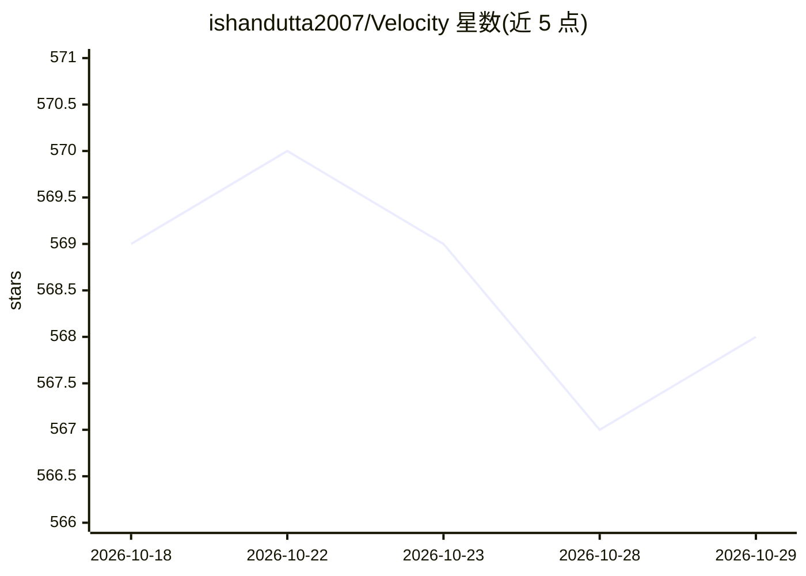

# ishandutta2007/Velocity

⭐ 568 · TypeScript · GPL-2.0 · 推送 2026-09-07 · [GitHub](https://github.com/ishandutta2007/Velocity) · 个人维护

**开源 web 原生 agent-first AI 编程 IDE 与通用 LLM 网关**

面向开发者的开源项目，目标是构建 web 原生、agent 优先的集成开发环境，以通用网关接入任意 LLM（GPT-4、Claude、Gemini、Llama 3、Deepseek 等），支持将高层任务委托给自主 agent 计划、编写与验证代码，并支持多 agent 并行协作。已实现的后端核心包括 14 表 SQLite 迁移层、消息总线、分布式文件锁、agent 记忆快照与成本上限记录。开发运行需 Docker、Node.js v20+ 与 Python 3.11+，通过 docker-compose 启动。README 声明项目处于实验/测试阶段，仅供研究开发用途。

## 筛选速览

| 维度 | 判定 | 备注 |
|---|---|---|
| AI 角色 | `ai-native` | 本体是模型或模型工具 |
| 许可风险 | `viral` | GPL-2.0 |
| 部署形态 | `self-host` | docker 或自建部署 |
| 模型依赖 | — | README 未给出锁定关系 |
| 硬件要求 | — | 无带数字的原话,不猜 |
| 安装摩擦 | `low` | 无编译、无系统依赖或容器化 |
| 成熟度 | `idea` | |

## 能力要点

- 通用 LLM 网关，统一接口接入 GPT-4/Claude/Gemini/Llama 3/Deepseek 等
- 多 agent 并行协作：层级 swarm、消息总线、分布式文件锁
- agent 记忆快照与按 MAX_COST_USD 的调用成本上限
- 14 表 SQLite 数据库层，含 WAL 与顺序迁移（0001–0014）

## 适用场景

- 在自托管的 IDE 中把编码任务委托给自主 agent
- 选用不同厂商模型驱动 agent 而不绑定单一 AI 提供商
- 多个 agent 并行处理项目不同部分并核验其产出工件

## 场景标签

`编码 Agent` `模型网关` `多智能体` · 领域:Agent 开发

## 证据(README 行号)

> L15: **Open Velocity** 🌌 is not just another code editor or AI assistant. It's an ambitious open-source project to build
> L29: - **🤖 Agent-First Workflow:** Delegate high-level tasks to autonomous agents that plan, write, and verify code.

## 星数曲线

2026-10-18 569 → 2026-10-29 568（-1）

---
*卡片 v1 · prompt 1.4 · 生成 2026-10-21 · 置信度 high · 依据 README sha `63ae4b374b0d` · [字段定义](../../DATASET.md)*
