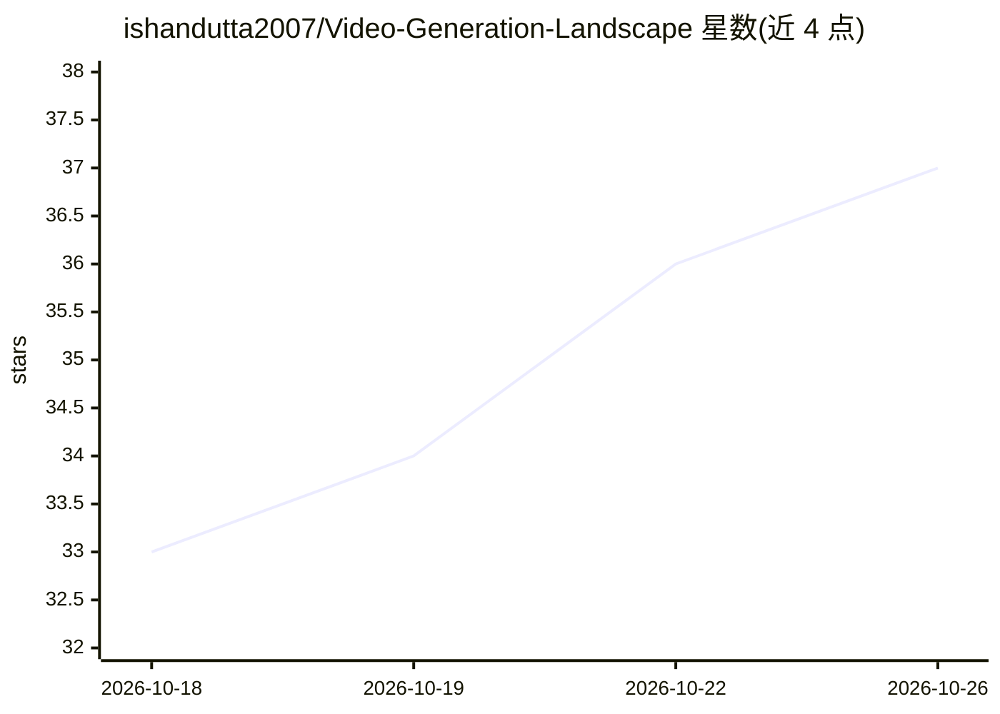

# ishandutta2007/Video-Generation-Landscape

⭐ 37 · MIT · 推送 2026-09-07 · [GitHub](https://github.com/ishandutta2007/Video-Generation-Landscape) · 个人维护

**AI 视频生成模型/论文/数据集的策展清单**

由个人维护的视频生成领域知识清单：收录 2024–2026 商业闭源与开源可下载权重的视频生成模型对比表（含开发者、特性、许可证），并列出 ComfyUI 等生态工具、关键研究论文、视频-文本数据集、社区入口及 2015–2022 的 GAN/VAE 早期时代历史存档。条目为表格与链接形式的索引，不提供可直接运行的代码，接受 PR 贡献。

## 筛选速览

| 维度 | 判定 | 备注 |
|---|---|---|
| AI 角色 | `ai-knowledge` | 知识聚合/清单类 |
| 许可风险 | `permissive` | MIT |
| 部署形态 | `None` |  |
| 模型依赖 | — | README 未给出锁定关系 |
| 硬件要求 | — | 无带数字的原话,不猜 |
| 安装摩擦 | `low` | 无编译、无系统依赖或容器化 |
| 成熟度 | — | 结构信号不足 |

## 能力要点

- 商业闭源与开源模型两张对比表（含许可证与特性）
- 覆盖 6 篇关键研究论文与 3 个大规模视频数据集
- 包含 2015–2022 早期 GAN/VAE 模型历史存档

## 适用场景

- 选型时对比各家文生视频/图生视频模型
- 查找视频生成领域论文与训练数据集
- 了解该领域从 GAN 到 DiT 的发展脉络

## 场景标签

`精选清单` · 领域:学习与行业

## 证据(README 行号)

> L5: ### A curated landscape of state-of-the-art video generation models, research papers, datasets, and creative workflo
> L57: ## 📄 Key Research Papers 📚

## 星数曲线

2026-10-18 33 → 2026-10-26 37（+4）

---
*卡片 v1 · prompt 1.4 · 生成 2026-10-25 · 置信度 high · 依据 README sha `bdc1bcca718a` · [字段定义](../../DATASET.md)*
