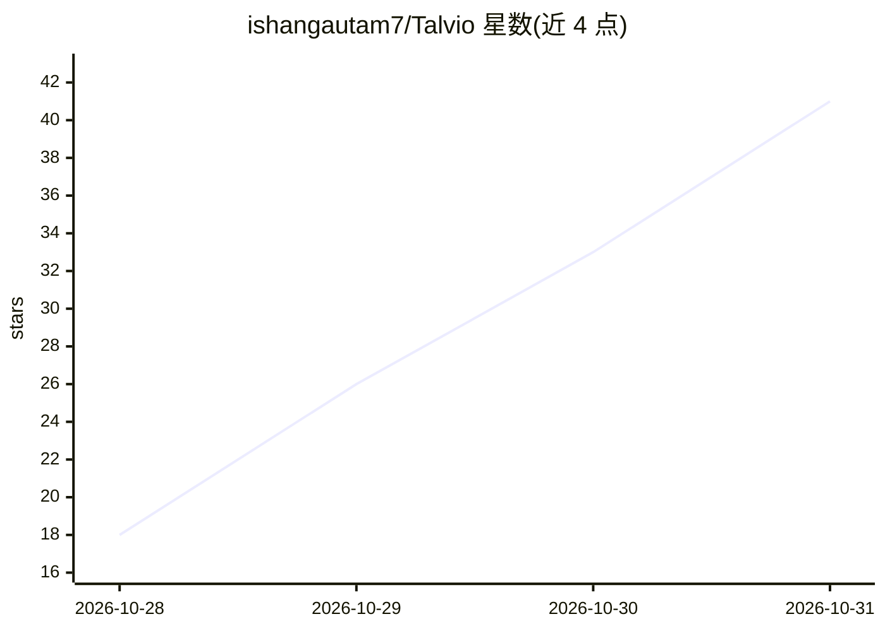

# ishangautam7/Talvio

⭐ 41 · Rust · MIT · 推送 2026-10-27 · [GitHub](https://github.com/ishangautam7/Talvio) · [官网](https://talvio.sentramind.dev) · 个人维护 · 中文 README

**本地优先的桌面语音助手：任意应用听写、语音执行命令与会议记录**

用 Tauri 构建、覆盖 Windows/macOS/Linux/Android 的语音工具：按住快捷键在任意应用听写，语音转文字默认经 transcribe.cpp 在本机 GPU/CPU 运行（69 个模型目录，含 Parakeet/Nemotron/Whisper），云端 provider 可选且需自带 key。还提供朗读回答并可操作电脑的助手（开应用、发邮件、日历）、免提通话、AI 文本清理（可用内置 llama.cpp 引擎跑本地模型）、双轨录音的会议转写与纪要，以及把手机当麦克风/遥控器的 Android 端。安装包未签名，macOS 需手动去隔离属性。

## 筛选速览

| 维度 | 判定 | 备注 |
|---|---|---|
| AI 角色 | `ai-native` | 本体是模型或模型工具 |
| 许可风险 | `permissive` | MIT |
| 部署形态 | `desktop` | 安装包/桌面程序 |
| 模型依赖 | local-ok | 支持本地模型 |
| 硬件要求 | — | 无带数字的原话,不猜 |
| 安装摩擦 | `low` | 无编译、无系统依赖或容器化 |
| 成熟度 | — | 结构信号不足 |

## 能力要点

- 本机 GPU/CPU 运行语音转文字（transcribe.cpp，69 个模型目录）
- 语音命令可操作本机应用：开应用、发邮件、建日历事件等
- 会议双轨录音（麦克风与系统声音）实时转写并生成纪要
- 手机 App 作为无线麦克风与遥控器

## 适用场景

- 我想按住快捷键在任意应用里说话打字
- 我想用语音让电脑代我发邮件、放歌、建日程
- 我想给线上会议录音转写并自动出纪要

## 场景标签

`语音 Agent` `语音识别` `语音合成` · 领域:对话与助手

## 证据(README 行号)

> L9: Local-first: speech is transcribed on your own computer unless you choose a cloud provider.
> L26: - **Runs on your computer.** Speech-to-text runs locally on transcribe.cpp (Parakeet, Nemotron, Whisper and the res

## 星数曲线

2026-10-28 18 → 2026-10-31 41（+23）

---
*卡片 v1 · prompt 1.4 · 生成 2026-10-28 · 置信度 high · 依据 README sha `3713b7633c04` · [字段定义](../../DATASET.md)*
