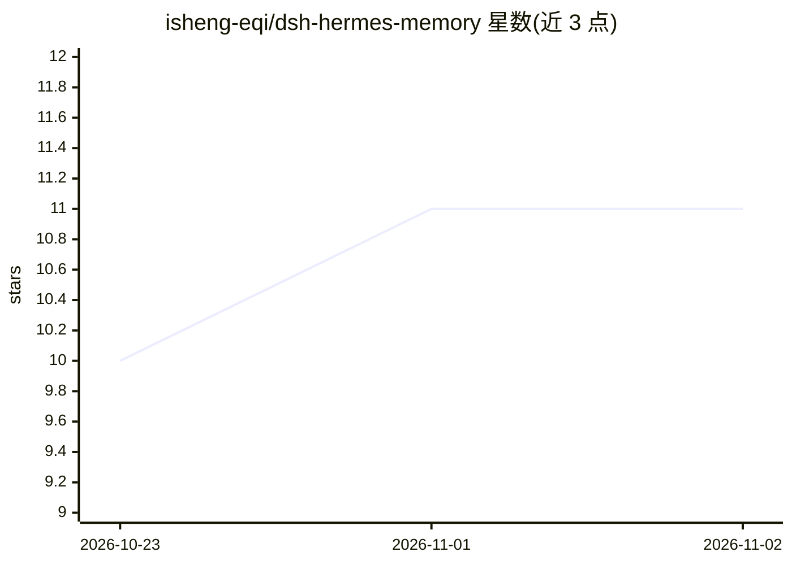

# isheng-eqi/dsh-hermes-memory

⭐ 11 · JavaScript · MIT · 推送 2026-11-01 · [GitHub](https://github.com/isheng-eqi/dsh-hermes-memory) · 个人维护 · 中文 README

**DeepSeek Harness 的双库持久记忆插件，附网页管理面板**

为 DeepSeek Harness (DSH) 提供 Hermes 风格的持久记忆：把 agent 记忆分为 MEMORY.md（世界事实，2200 字符上限）与 USER.md（用户画像，1375 字符上限）两个独立库，各自预算与淘汰；模型经单一 memory 工具自主策展（add/replace/remove/batch），无内部 LLM 调用；每会话注入冻结快照以保前缀缓存。存储为 DSH 原生 json 单元（原子写、跨重启持久），并附 Web 侧边栏记忆面板供查看/编辑/删除/添加。机制移植自 NousResearch/hermes-agent 的 MemoryStore，未实现 write_approval 审批门与提示注入扫描。

## 筛选速览

| 维度 | 判定 | 备注 |
|---|---|---|
| AI 角色 | `ai-ecosystem` | LLM/agent 周边工具 |
| 许可风险 | `permissive` | MIT |
| 部署形态 | `None` |  |
| 模型依赖 | locked-api |  |
| 硬件要求 | — | 无带数字的原话,不猜 |
| 安装摩擦 | `low` | 无编译、无系统依赖或容器化 |
| 成熟度 | — | 结构信号不足 |

## 能力要点

- 双库分离：MEMORY.md 与 USER.md 各自字符上限与淘汰策略
- 单一 memory 工具策展，工具内部无 LLM，零额外调用成本
- 会话开始注入冻结快照，中途写入不改快照以保前缀缓存
- DSH Web 侧边栏记忆面板，与模型工具读写同一存储

## 适用场景

- 让 DSH agent 跨会话记住项目约定与我的偏好
- 在网页面板里查看和修正模型策展的记忆条目
- 观察两个记忆库的用量占比与淘汰情况

## 场景标签

`Agent 记忆` · 领域:Agent 开发

## 证据(README 行号)

> L3: > Persistent memory for DeepSeek Harness (DSH) that keeps
> L7: **DeepSeek Harness 的双库记忆插件**：把 agent 的记忆分成两个独立的库——MEMORY.md（关于世界的事实：环境、项目约定、工具怪癖）和 USER.md（关于你的画像：偏好、沟通风格、工作习惯），各自独立
> L83: 安装后插件在**部署级**生效（所有会话可见）：模型获得 `memory` / `memory_search` / `memory_list` / `memory_stats` / `memory_debug` 工具，每个会话开始

## 星数曲线

2026-10-23 10 → 2026-11-02 11（+1）

---
*卡片 v1 · prompt 1.4 · 生成 2026-11-02 · 置信度 high · 依据 README sha `85fe03679c23` · [字段定义](../../DATASET.md)*
