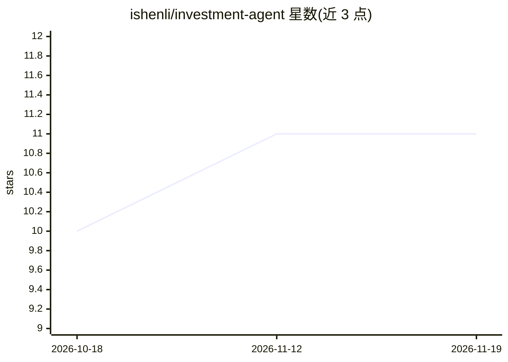

# ishenli/investment-agent

⭐ 11 · TypeScript · MIT · 推送 2026-11-08 · [GitHub](https://github.com/ishenli/investment-agent) · [官网](https://ishenli.github.io/investment-agent/) · 个人维护 · 中文 README

**本地运行的 AI 投资助理：管理股票基金并生成投资分析**

本地运行的投资分析工具，采用多引擎 agent 架构（DeepAgents、Claude Agent SDK、Hermes），提供股票/基金/黄金行情查询、持仓与盈亏跟踪、投资笔记语义检索、自然语言转 SQL 查询与网页搜索调研。支持微信、飞书、Web 三种消息通道，聊天中可内嵌经校验的行情卡片与交易意图卡片（需确认才执行）。三级权限模式与 ContentGuard 安全层控制 agent 操作，trace/指标/成本数据存入 SQLite。需 Node.js 18+，数据全部保留在本地。

## 筛选速览

| 维度 | 判定 | 备注 |
|---|---|---|
| AI 角色 | `ai-native` | 本体是模型或模型工具 |
| 许可风险 | `permissive` | MIT |
| 部署形态 | `library` | 以包/库形式分发 |
| 模型依赖 | locked-api |  |
| 硬件要求 | — | 无带数字的原话,不猜 |
| 安装摩擦 | `low` | 无编译、无系统依赖或容器化 |
| 成熟度 | — | 结构信号不足 |

## 能力要点

- DeepAgents / Claude / Hermes 三引擎统一接口，可切换
- 微信（iLink 长轮询）、飞书（WebSocket SDK）、Web 多通道接入
- 三级权限模式（safe/auto/full-access）+ ContentGuard 安全层
- Agent 可观测性：trace/span、token 指标、按会话成本追踪

## 适用场景

- 统一管理美股、港股与国内基金的持仓与盈亏
- 通过微信或飞书随时向 AI 助理查询行情与分析
- 对投资组合数据用自然语言提问并生成图表卡片

## 场景标签

`金融量化` `AI 助手` · 领域:对话与助手

## 证据(README 行号)

> L3: AI-powered local investment analysis tool with multi-engine agent architecture for comprehensive stock market analys
> L30: ### Multi-Engine AI Architecture
> L73: ### Investment Management

## 星数曲线

2026-10-18 10 → 2026-11-19 11（+1）

---
*卡片 v1 · prompt 1.4 · 生成 2026-11-18 · 置信度 high · 依据 README sha `074535ced599` · [字段定义](../../DATASET.md)*
