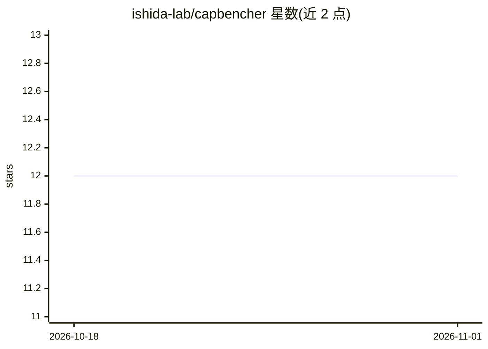

# ishida-lab/capbencher

⭐ 12 · Python · MIT · 推送 2026-05-29 · [GitHub](https://github.com/ishida-lab/capbencher) · [官网](https://arxiv.org/abs/2505.18102) · 组织维护

**为 LLM 基准添加泄漏与刷榜警报的评测工具包**

通过在基准题目中注入已知上限的随机指令（如随机选前后选项、随机加减一），设定得分的理论上限，使统计显著超出上限的准确率成为数据泄漏、污染或榜单作弊的信号；同时支持在公开评测中不披露真实标注答案。覆盖多选题、直接作答数学题与代码生成三类任务，提供 dataset_zoo 加载器扩展、QA/代码评测脚本与可选的持续预训练脚本（需 GPU），评测可经 OpenRouter/OpenAI 等 API 运行。

## 筛选速览

| 维度 | 判定 | 备注 |
|---|---|---|
| AI 角色 | `ai-ecosystem` | LLM/agent 周边工具 |
| 许可风险 | `permissive` | MIT |
| 部署形态 | `None` |  |
| 模型依赖 | — | README 未给出锁定关系 |
| 硬件要求 | — | 无带数字的原话,不猜 |
| 安装摩擦 | `low` | 无编译、无系统依赖或容器化 |
| 成熟度 | — | 结构信号不足 |

## 能力要点

- 为基准设置精度上限，超限即提示泄漏/污染/榜单作弊
- 支持公开可复现评测而不披露真实答案
- 覆盖 QA（MMLU/GSM8K 类）与代码生成（HumanEval 类）任务
- 可选持续预训练脚本与 dataset_zoo 自定义加载器扩展

## 适用场景

- 构建防刷榜、可检测污染的 LLM 基准
- 对模型做带泄漏警报的评测与排名
- 在 capped 基准数据上做持续预训练实验

## 场景标签

`模型评测` · 领域:评测与运维

## 证据(README 行号)

> L7: CapBencher is a protocol for “capping” benchmark accuracy by design, setting a known ceiling on the best achievable 
> L51: ## Evaluation

## 星数曲线

2026-10-18 12 → 2026-11-01 12（+0）

---
*卡片 v1 · prompt 1.4 · 生成 2026-11-01 · 置信度 high · 依据 README sha `41fbcb5d6e56` · [字段定义](../../DATASET.md)*
