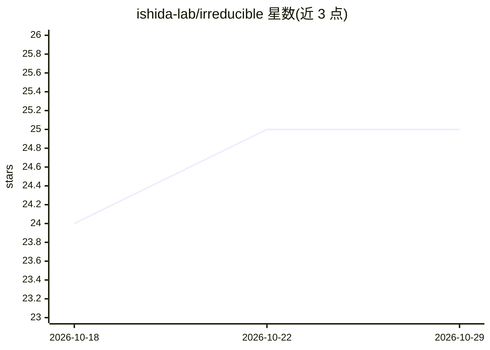

# ishida-lab/irreducible

⭐ 25 · Python · GPL-3.0 · 推送 2026-08-18 · [GitHub](https://github.com/ishida-lab/irreducible) · 组织维护

**二分类 Bayes 错误率直接估计方法的论文实现与数据集**

ICLR 2023 论文（Notable-top-5%）的官方代码实现：通过取不确定类别标签的均值，直接估计二分类问题的 Bayes 错误率，方法 model-free、instance-free、无超参数，可用于评估高性能分类器与检测测试集过拟合。提供合成实验、CIFAR-10H/Fashion-MNIST-H 基准实验与 ICLR 论文接收决策实验的脚本，并随仓库发布含多个人工标注的 Fashion-MNIST-H 数据集（10,000 测试图像、每图多标注者）。面向机器学习研究者复现论文与使用软标签数据。

## 筛选速览

| 维度 | 判定 | 备注 |
|---|---|---|
| AI 角色 | `ai-native` | 本体是模型或模型工具 |
| 许可风险 | `viral` | GPL-3.0 |
| 部署形态 | `None` |  |
| 模型依赖 | — | README 未给出锁定关系 |
| 硬件要求 | — | 无带数字的原话,不猜 |
| 安装摩擦 | `low` | 无编译、无系统依赖或容器化 |
| 成熟度 | — | 结构信号不足 |

## 能力要点

- 对不确定类别标签取均值的 Bayes 错误率直接估计，无超参数、model-free
- 覆盖合成数据、CIFAR-10H/Fashion-MNIST-H 与 ICLR 接收决策四组实验脚本
- 发布 Fashion-MNIST-H 数据集：10,000 张测试图像的多人工标注（计数/比例/原始标注三种文件）
- 支持弱监督数据下的 Bayes 错误估计

## 适用场景

- 复现 ICLR 2023 论文中的 Bayes 错误估计实验
- 判断高性能深度网络是否已接近数据集的 Bayes 错误率
- 获取 Fashion-MNIST-H 软标签/概率标注用于其他需要软标签的任务

## 场景标签

`模型评测` · 领域:评测与运维

## 证据(README 行号)

> L5: We provide implementation of "Is the Performance of My Deep Network Too Good to Be True? A Direct Approach to Estima
> L11: > There is a fundamental limitation in the prediction performance that a machine learning model can achieve due to 

## 星数曲线

2026-10-18 24 → 2026-10-29 25（+1）

---
*卡片 v1 · prompt 1.4 · 生成 2026-10-27 · 置信度 high · 依据 README sha `4882cd094477` · [字段定义](../../DATASET.md)*
