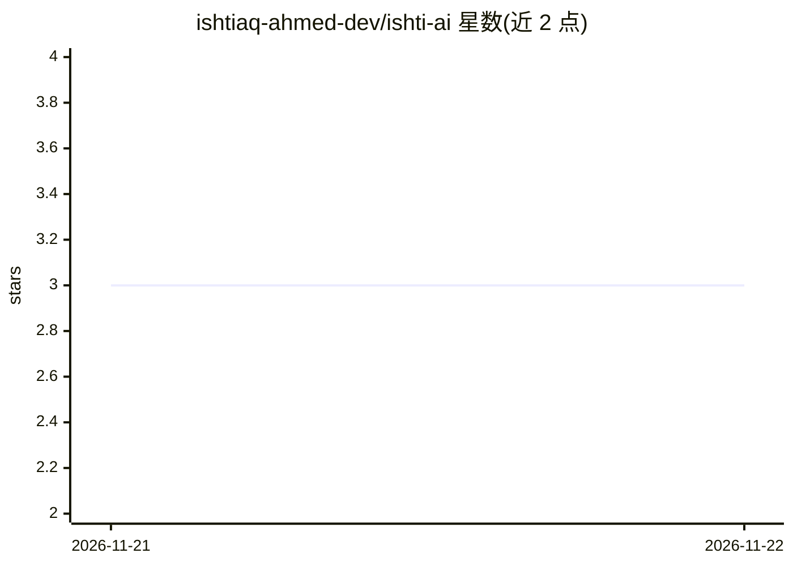

# ishtiaq-ahmed-dev/ishti-ai

⭐ 3 · Python · MIT · 推送 2026-11-20 · [GitHub](https://github.com/ishtiaq-ahmed-dev/ishti-ai) · [官网](https://github.com/ishtiaq-ahmed-dev/ishti-ai#readme) · 个人维护

**Windows 本地优先的个人 AI 助手：语音、记忆、120+ 技能与 MCP 工具**

面向 Windows 10/11 的个人 AI 助手，支持语音唤醒与端上 Whisper/Kokoro 语音、提醒日历笔记、文件读取（PDF/Word/Excel）、历史对话检索，内置 123 个技能并可作为 MCP 客户端与服务器接入外部工具。运行路径二选一：本机 Ollama 本地模型（需 NVIDIA GPU 8GB+）或任意 OpenAI 兼容 API，含故障自动回退。安全机制上，发送/删除/支付需一次性确认，Python 在无网络的 Docker 沙箱执行。仅支持 Windows，暂无浏览器自动化。

## 筛选速览

| 维度 | 判定 | 备注 |
|---|---|---|
| AI 角色 | `ai-native` | 本体是模型或模型工具 |
| 许可风险 | `permissive` | MIT |
| 部署形态 | `library` | 以包/库形式分发 |
| 模型依赖 | local-ok | 支持本地模型 |
| 硬件要求 | — | 无带数字的原话,不猜 |
| 安装摩擦 | `low` | 无编译、无系统依赖或容器化 |
| 成熟度 | — | 结构信号不足 |

## 能力要点

- 120+ 技能与 MCP 客户端/服务器双角色，SKILL.md 技能可从文件夹或 URL 安装
- 本地 Ollama 或任意 OpenAI 兼容 API，云失败时自动回退到轻量本地模型
- 规则层零模型调用，其余至多一次模型调用；发送/删除/支付均需一次性确认
- 端上 Whisper 与 Kokoro 语音，支持 WhatsApp/Telegram/Discord/Slack 渠道

## 适用场景

- 在本地离线运行一个能语音对话、管提醒和读文件的私人助手
- 通过 WhatsApp 或 Telegram 远程向家里的 PC 下达指令
- 给助手接入 GitHub 等 MCP 服务器扩展工具能力

## 场景标签

`AI 助手` `语音 Agent` · 领域:对话与助手

## 证据(README 行号)

> L4:  A private, local-first personal AI assistant for Windows
> L6:  Talk or type. ISHTI remembers, reminds, searches, reads your files, runs 120+ skills and plugs into any MCP tool,
> L114: |Brain|`ishti/brain.py`|One model call over a shortlist of skills; multi-step plans become a journaled workflow|

## 星数曲线

2026-11-21 3 → 2026-11-22 3（+0）

---
*卡片 v1 · prompt 1.4 · 生成 2026-11-21 · 置信度 mid · 依据 README sha `f9ca2329625e` · [字段定义](../../DATASET.md)*
