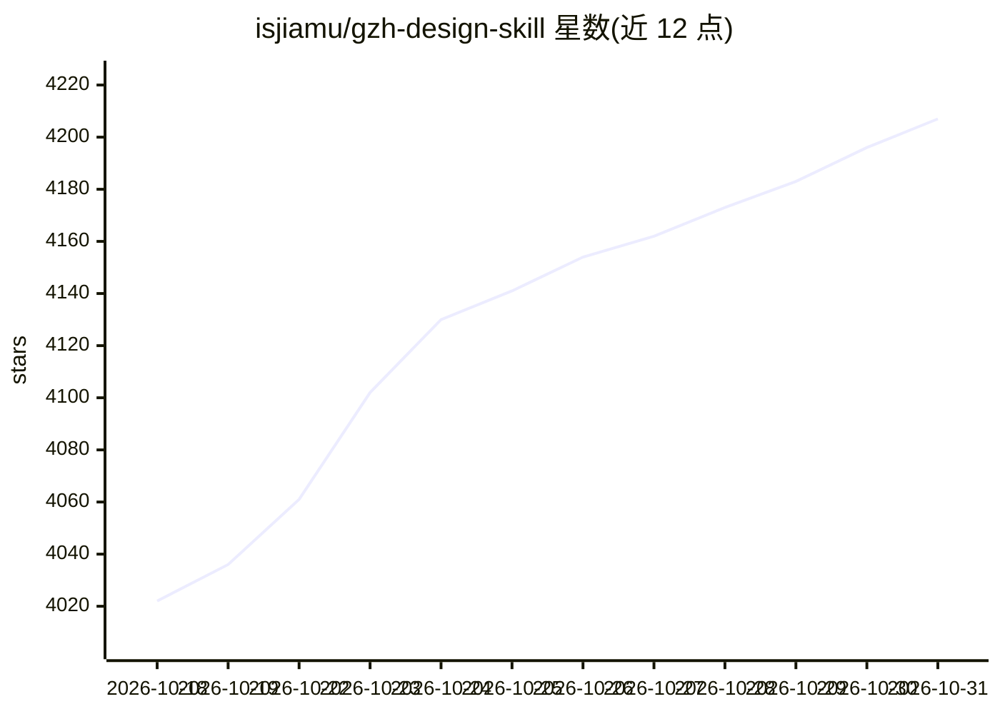

# isjiamu/gzh-design-skill

⭐ 4,207 · HTML · NOASSERTION · 推送 2026-10-21 · [GitHub](https://github.com/isjiamu/gzh-design-skill) · [官网](https://github.com/AlephMuYe) · 个人维护 · 中文 README

**给 AI Agent 用的公众号排版技能：Markdown 一键转可粘贴 HTML**

面向 Claude Code / Codex / Cursor 等 Agent 的排版 Skill：读取 Markdown，按 6 套内置主题（摸鱼绿/红白/石墨极简/留白禅意/摸鱼票据/橄榄手记）装配样式全内联的 HTML，可直接粘贴进微信公众号编辑器；支持章节自动编号、关键词下划线、代码块/图片/GIF，并由 component_lint.py 与 validate_gzh_html.py 双脚本校验平台限制。另提供主题生成器，可用一句话或参考图生成自定义主题组件库。声明不依赖特定模型，国内外模型均可运行；不代写文章，仅排版。

## 筛选速览

| 维度 | 判定 | 备注 |
|---|---|---|
| AI 角色 | `ai-ecosystem` | LLM/agent 周边工具 |
| 许可风险 | `viral` | NOASSERTION |
| 部署形态 | `library` | 以包/库形式分发 |
| 模型依赖 | — | README 未给出锁定关系 |
| 硬件要求 | — | 无带数字的原话,不猜 |
| 安装摩擦 | `low` | 无编译、无系统依赖或容器化 |
| 成熟度 | — | 结构信号不足 |

## 能力要点

- 6 套内置主题组件库（设计变量+组件+配方表）
- 主题生成器：一句话/参考图生成新主题并可复用
- 双关卡脚本校验（component_lint.py + validate_gzh_html.py）保证 0 ERROR 交付
- 全内联样式规避公众号过滤的写法（<style>/class/grid 等）

## 适用场景

- 写完 Markdown 后让 Agent 排成公众号文章直接粘贴发布
- 按文章题材自动选主题并获得稳定排版
- 用参考图或描述生成自定义公众号排版主题

## 场景标签

 · 领域:内容排版/Agent 技能

## 证据(README 行号)

> L17: 一个给 AI Agent（Claude Code / Codex / Cursor 等）用的公众号排版 Skill。你写完 Markdown，它按你选的主题，生成**样式全内联、粘贴到公众号编辑器不掉格式**的 HTML——自动编
> L146: - **Agent 友好** — 输入输出全是纯文本 Markdown / HTML，任何 Agent 都能读、写、改、验，天然适配 Claude Code / Codex / Cursor。
> L152: ├── SKILL.md                    # 排版工作流主文档（Agent 入口）

## 星数曲线

2026-10-18 4,022 → 2026-10-31 4,207（+185）

---
*卡片 v1 · prompt 1.4 · 生成 2026-10-20 · 置信度 high · 依据 README sha `1c4821bc2d9f` · [字段定义](../../DATASET.md)*
