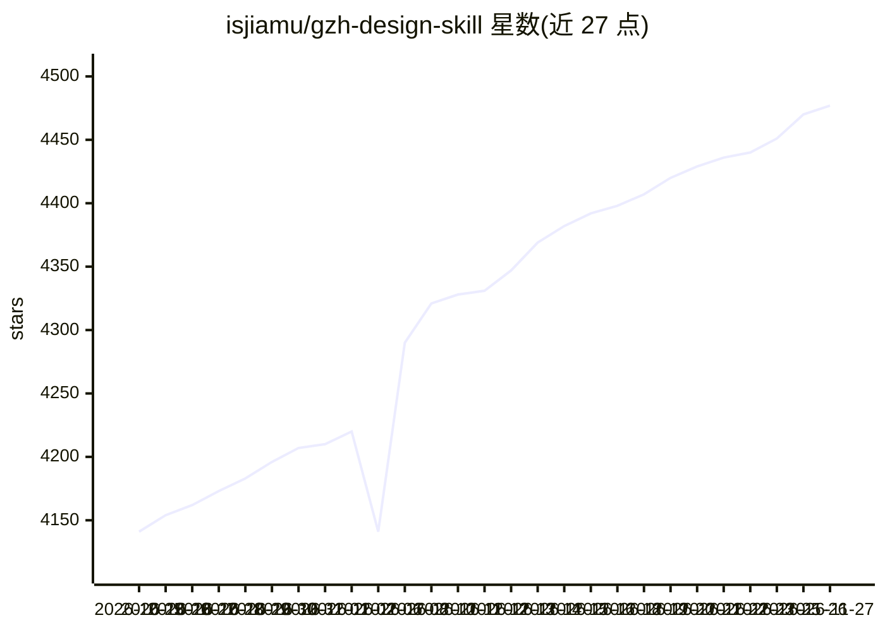

# isjiamu/gzh-design-skill

⭐ 4,477 · HTML · NOASSERTION · 推送 2026-10-21 · [GitHub](https://github.com/isjiamu/gzh-design-skill) · [官网](https://github.com/AlephMuYe) · 个人维护 · 中文 README

**给 AI Agent 用的公众号排版技能：Markdown 生成可粘贴 HTML**

以 Skill 形式供 Claude Code / Codex / Cursor 等 Agent 加载的排版工作流：读取用户的 Markdown，按 6 套内置主题（含主题生成器可自造）生成样式全内联的 HTML，处理章节编号、关键词下划线、引言卡、目录、代码块与图片，并内置公众号平台限制的兜底规则。质量由 component_lint.py 与 validate_gzh_html.py 两个脚本做确定性校验，须 0 ERROR 才交付；提供 npx 安装、git clone 与让 Agent 自行接入三种安装方式。仅排版不代写内容。

## 筛选速览

| 维度 | 判定 | 备注 |
|---|---|---|
| AI 角色 | `ai-native` | 本体是模型或模型工具 |
| 许可风险 | `viral` | NOASSERTION |
| 部署形态 | `library` | 以包/库形式分发 |
| 模型依赖 | — | README 未给出锁定关系 |
| 硬件要求 | — | 无带数字的原话,不猜 |
| 安装摩擦 | `low` | 无编译、无系统依赖或容器化 |
| 成熟度 | — | 结构信号不足 |

## 能力要点

- 6 套内置主题 + 一句话/参考图生成新主题并本地复用
- 样式全内联规避公众号过滤写法，双关卡校验脚本确定性检查
- 自动章节编号、关键词下划线、全角标点规范化与签名合并
- 生成带复制按钮的预览页，一键粘贴进公众号编辑器

## 适用场景

- 把写好的 Markdown 长文一键排成公众号文章
- 为不同题材选主题或让 AI 现造一套自定义主题
- Word/PDF 稿归一化后排版发布到公众号
- 批量生成多套主题供挑选对比

## 场景标签

 · 领域:内容创作/排版工具

## 证据(README 行号)

> L19: 一个给 AI Agent（Claude Code / Codex / Cursor 等）用的公众号排版 Skill。你写完 Markdown，它按你选的主题，生成**样式全内联、粘贴到公众号编辑器不掉格式**的 HTML——自动编
> L29: - **双关卡质量校验**：`component_lint.py`（组件库源头）+ `validate_gzh_html.py`（最终产物），构成可复现的「改→验→修」闭环。

## 星数曲线

2026-10-25 4,141 → 2026-11-27 4,477（+336）

---
*卡片 v1 · prompt 1.4 · 生成 2026-11-22 · 置信度 high · 依据 README sha `07cf76b159a9` · [字段定义](../../DATASET.md)*
