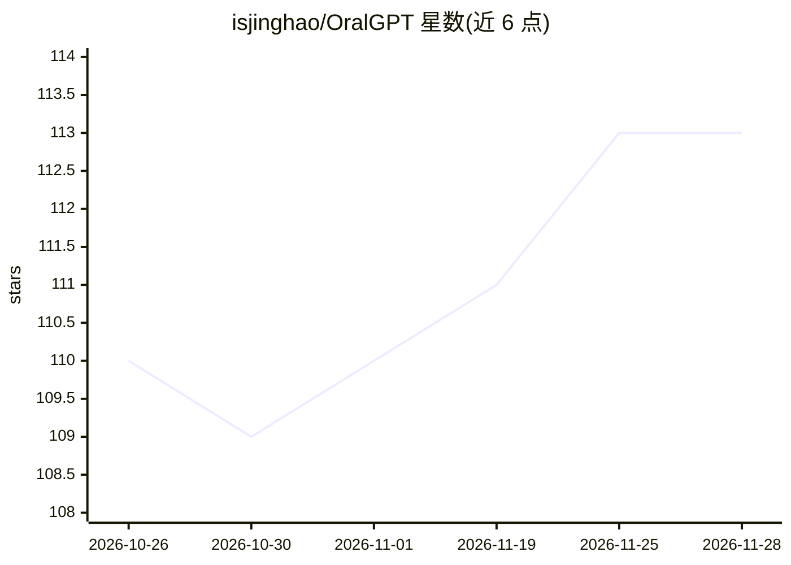

# isjinghao/OralGPT

⭐ 113 · Python · 推送 2026-11-24 · [GitHub](https://github.com/isjinghao/OralGPT) · [官网](https://arxiv.org/abs/2509.09254) · 组织维护

**牙科多模态大模型与基准测试集系列，面向口腔影像分析**

OralGPT 系列是面向数字牙科的 AI 模型与基准合集，涵盖全景 X 光分析的多模态大模型、跨口内照片/视频/放射影像的通用模型、经强化学习使用视觉工具的变体、开放词汇检测器与牙菌斑分割模型，并发布 MMOral 系列评测基准与评估工具包。仓库内含训练与评估入口、数据生成脚本，权重发布在 Hugging Face，LLaMA-Factory 作为上游训练框架被收入仓库。论文发表于 NeurIPS 2025 与 CVPR 2026。

## 筛选速览

| 维度 | 判定 | 备注 |
|---|---|---|
| AI 角色 | `ai-native` | 本体是模型或模型工具 |
| 许可风险 | `none` | — |
| 部署形态 | `None` |  |
| 模型依赖 | — | README 未给出锁定关系 |
| 硬件要求 | — | 无带数字的原话,不猜 |
| 安装摩擦 | `low` | 无编译、无系统依赖或容器化 |
| 成熟度 | — | 结构信号不足 |

## 能力要点

- OralGPT-Omni 支持口内照片/视频、放射影像、组织病理与文本多模态输入
- OralDetect 开放词汇检测器覆盖 5 种成像模态，附 oraldetect-finetune agent 技能
- MMOral-OPG-Bench 已接入 VLMEvalKit，提供 MMOral-Bench-EvalKit 评估工具
- MMOral-OPG 数据生成脚本支持属性、对话、报告、VQA 生成

## 适用场景

- 评估自有 MLLM 在牙科全景 X 光理解任务上的表现
- 对全景片、口内影像进行诊断推理与描述生成
- 在自采牙科影像上微调开放词汇检测模型
- 获取中文口腔 11 个亚专科的多选题评测集

## 场景标签

`模型评测` `多模态` `微调` `强化学习` · 领域:评测与运维

## 证据(README 行号)

> L37: **OralGPT** is a family of dental AI **models** and **benchmarks** for digital dentistry, covering multimodal large
> L71: |**OralGPT**|Dental MLLM for panoramic X-ray analysis, with chain-of-thought diagnostic reasoning|NeurIPS 2025|MMOr
> L85: Clinical evaluation sets. Run MMOral language-model benchmarks with MMOral-Bench-EvalKit.

## 星数曲线

2026-10-26 110 → 2026-11-28 113（+3）

---
*卡片 v1 · prompt 1.4 · 生成 2026-11-28 · 置信度 high · 依据 README sha `faf23b9e39fd` · [字段定义](../../DATASET.md)*
