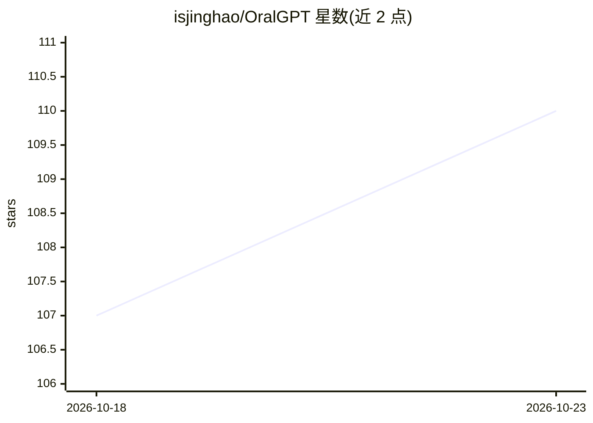

# isjinghao/OralGPT

⭐ 110 · Python · 推送 2026-10-20 · [GitHub](https://github.com/isjinghao/OralGPT) · [官网](https://arxiv.org/abs/2509.09254) · 组织维护 · 中文 README

**牙科数字医学的多模态模型与评测基准家族（OralGPT）**

面向口腔医学的 AI 模型与基准集合：包含针对全景 X 光、口内照片/视频、病理切片等多模态输入的牙科多模态大模型（OralGPT、OralGPT-Omni、OralGPT-Plus 等）、开放词汇检测器 OralDetect、图像生成/翻译模型 OralGPT-X，以及 MMOral 系列临床评测基准与评测工具包。给科研人员提供论文、基准与评测工具，给开发者提供仓库内训练/评测入口和 Hugging Face 权重。多项成果发表于 NeurIPS/CVPR 等会议，部分模型与基准仍在开发中。

## 筛选速览

| 维度 | 判定 | 备注 |
|---|---|---|
| AI 角色 | `ai-native` | 本体是模型或模型工具 |
| 许可风险 | `none` | — |
| 部署形态 | `None` |  |
| 模型依赖 | — | README 未给出锁定关系 |
| 硬件要求 | — | 无带数字的原话,不猜 |
| 安装摩擦 | `low` | 无编译、无系统依赖或容器化 |
| 成熟度 | — | 结构信号不足 |

## 能力要点

- 牙科多模态大模型家族，覆盖 X 光、口内影像、病理切片等输入
- MMOral 系列临床评测基准，条目由临床牙医审核
- OralDetect 五种成像模态开放词汇检测，权重已发布
- 仓库含评测工具包与训练/评测入口，权重托管于 Hugging Face

## 适用场景

- 用牙科多模态大模型做全景 X 光分析与诊断推理
- 评测多模态语言模型在牙科影像理解上的表现
- 在自有牙科影像上运行开放词汇检测

## 场景标签

`模型评测` `多模态` `科研工具` · 领域:评测与运维

## 证据(README 行号)

> L37: **OralGPT** is a family of dental AI **models** and **benchmarks** for digital dentistry, covering multimodal large
> L70: |**OralGPT**|Dental MLLM for panoramic X-ray analysis, with chain-of-thought diagnostic reasoning|NeurIPS 2025|MMOr
> L88: |**MMOral-OPG-Bench**|Open- and closed-ended panoramic X-ray understanding. Items are reviewed by clinical dentists

## 星数曲线

2026-10-18 107 → 2026-10-23 110（+3）

---
*卡片 v1 · prompt 1.4 · 生成 2026-10-23 · 置信度 high · 依据 README sha `402126e33268` · [字段定义](../../DATASET.md)*
