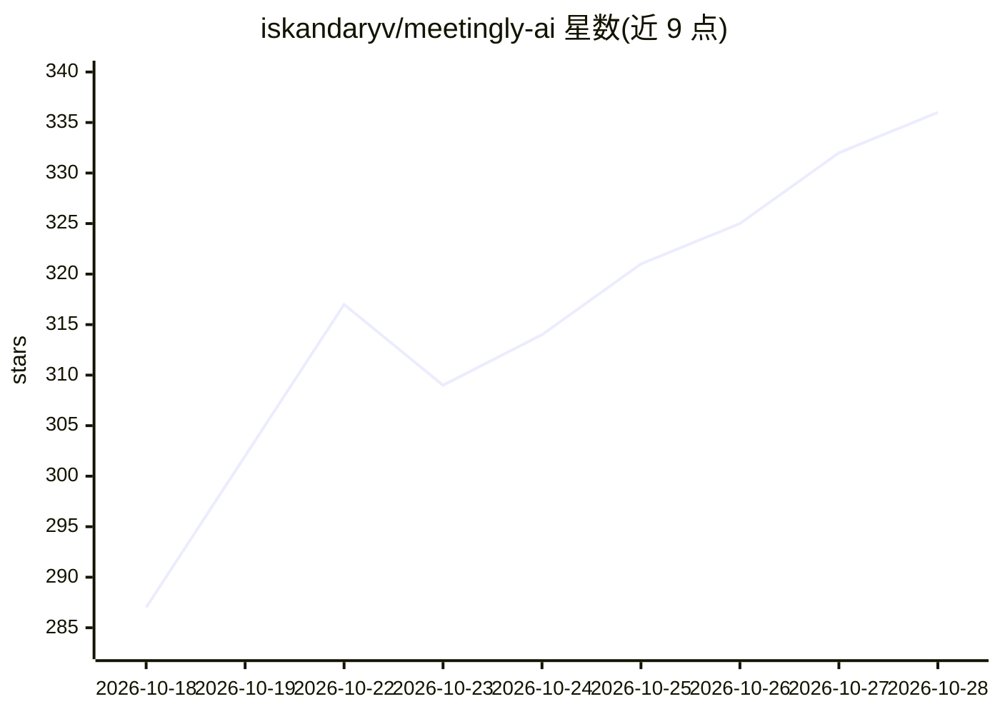

# iskandaryv/meetingly-ai

⭐ 337 · TypeScript · Apache-2.0 · 推送 2026-10-21 · [GitHub](https://github.com/iskandaryv/meetingly-ai) · [官网](https://meetinglyai.com) · 个人维护 · 中文 README

**开源 AI 面试与会议助手：通话中实时转写并给出答案**

跨 Windows/macOS/Linux 的 Electron 桌面应用：捕获电脑音频（无需机器人入会），默认用 NVIDIA Nemotron 在本地转写 28 种语言，识别到提问后生成可念的答案与要点；支持屏幕分析读题作答、会议报告、转录保存为 txt。回答可走免费托管计划，或自带 OpenAI/OpenRouter/Ollama 等 key。提供 Windows/macOS/Linux 安装包，Apache-2.0 开源；Linux 无屏幕共享隐藏保护，安装包未签名。

## 筛选速览

| 维度 | 判定 | 备注 |
|---|---|---|
| AI 角色 | `ai-native` | 本体是模型或模型工具 |
| 许可风险 | `permissive` | Apache-2.0 |
| 部署形态 | `desktop` | 安装包/桌面程序 |
| 模型依赖 | local-ok | 支持本地模型 |
| 硬件要求 | — | 无带数字的原话,不猜 |
| 安装摩擦 | `low` | 无编译、无系统依赖或容器化 |
| 成熟度 | — | 结构信号不足 |

## 能力要点

- 本地语音转写（Nemotron，28 种语言，约 560 MB）
- 自带 key 支持 OpenAI/OpenRouter/Ollama 及任意 OpenAI 兼容端点，可全离线
- 屏幕分析读取编码题/幻灯片并给出解答
- Windows/macOS 使用 OS 屏幕捕获保护，对屏幕共享隐藏

## 适用场景

- 面试中实时获得针对提问的答案与追问建议
- 编码面试中读取屏幕上的题目并给出思路与代码
- 会议/讲座中获取实时双语转录、建议问题与会后报告

## 场景标签

`语音识别` `AI 助手` · 领域:对话与助手

## 证据(README 行号)

> L9: Meetingly is a free, open-source AI assistant for job interviews and live meetings on Windows, macOS and Linux. It l
> L35: - **Real answers, instantly.** When the other side asks something, press *Answer* (or let Pro's auto-answer do it):
> L43: - **Your own API key, or none of ours.** Use the free plan, or point Meetingly at OpenAI, OpenRouter, a local Ollam

## 星数曲线

2026-10-18 287 → 2026-10-28 336（+49）

---
*卡片 v1 · prompt 1.4 · 生成 2026-10-21 · 置信度 high · 依据 README sha `91d81cdaf9d1` · [字段定义](../../DATASET.md)*
