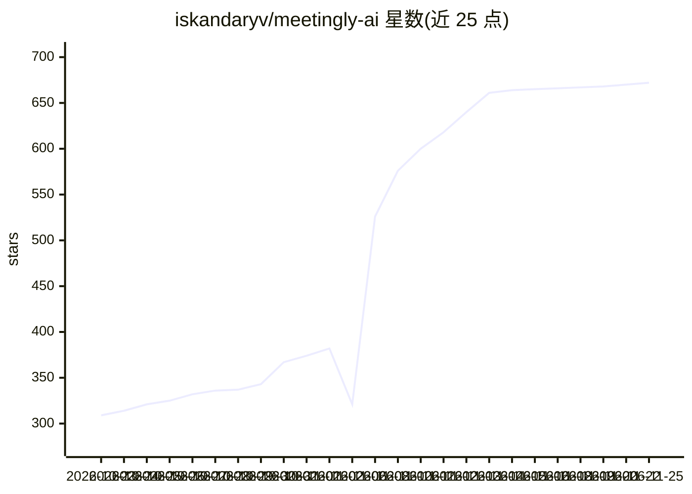

# iskandaryv/meetingly-ai

⭐ 672 · TypeScript · Apache-2.0 · 推送 2026-11-13 · [GitHub](https://github.com/iskandaryv/meetingly-ai) · [官网](https://meetinglyai.com) · 个人维护 · 中文 README

**求职者与会议参与者的实时 AI 应答与转录桌面助手**

Electron 桌面应用：捕获本机通话音频（Zoom/Google Meet/Teams 等），本地转录后生成可在屏幕上直接说出的回答，窗口默认不被屏幕共享收录。转录由 NVIDIA Nemotron、Parakeet Ultra、Qwen3-ASR 在设备端完成，覆盖 28 种语言；AI 回答可用免费账户（每日 50 次）、自有 OpenAI/OpenRouter/Ollama key 或任意 OpenAI 兼容端点。含屏幕内容分析、会议纪要、会话转存为 txt。Windows/macOS/Linux 提供安装包，代码 Apache-2.0。

## 筛选速览

| 维度 | 判定 | 备注 |
|---|---|---|
| AI 角色 | `ai-native` | 本体是模型或模型工具 |
| 许可风险 | `permissive` | Apache-2.0 |
| 部署形态 | `desktop` | 安装包/桌面程序 |
| 模型依赖 | local-ok | 支持本地模型 |
| 硬件要求 | — | 无带数字的原话,不猜 |
| 安装摩擦 | `low` | 无编译、无系统依赖或容器化 |
| 成熟度 | — | 结构信号不足 |

## 能力要点

- 设备端语音转录 28 种语言，可完全离线运行
- 自有 key 模式：回答直连 OpenAI/OpenRouter/Ollama/兼容端点
- Windows/macOS 屏幕共享保护，Linux 不具备同等保护
- 会议结束生成摘要、决策与行动项报告

## 适用场景

- 求职面试时实时获取行为面与技术面问题的参考回答
- 编码面试中读取屏幕上的题目并生成解题思路和代码
- 纯转录模式记录会议内容，不启用 AI 也不需账户
- 销售与客户通话中即时应答并生成后续跟进纪要

## 场景标签

`语音识别` `AI 助手` · 领域:对话与助手

## 证据(README 行号)

> L9: Meetingly is a free, open-source AI assistant for job interviews and live meetings on Windows, macOS and Linux. It l
> L37: - **Speech recognition on your computer.** NVIDIA Nemotron transcribes locally in 28 languages as people speak. Whe
> L43: - **Your own API key, or none of ours.** Use the free plan, or point Meetingly at OpenAI, OpenRouter, a local Ollam

## 星数曲线

2026-10-23 309 → 2026-11-25 672（+363）

---
*卡片 v1 · prompt 1.4 · 生成 2026-11-25 · 置信度 high · 依据 README sha `c08076421dc9` · [字段定义](../../DATASET.md)*
