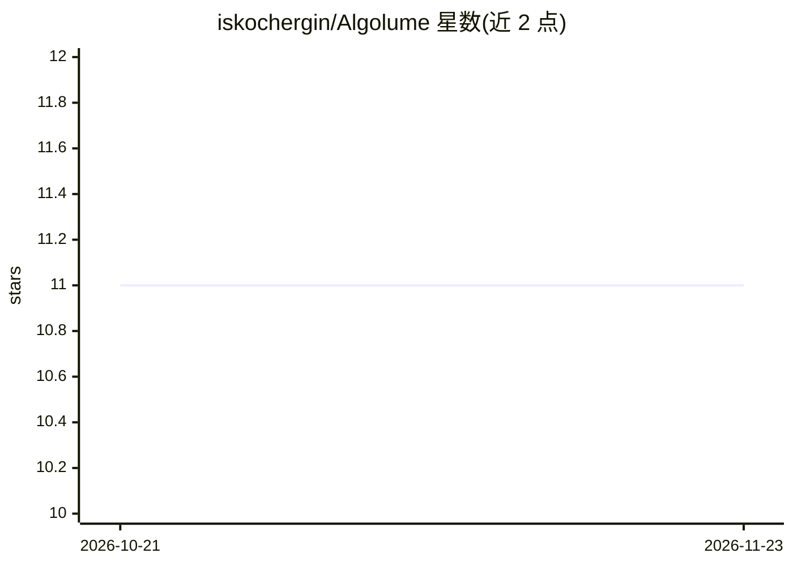

# iskochergin/Algolume

⭐ 11 · Python · NOASSERTION · 推送 2026-08-26 · [GitHub](https://github.com/iskochergin/Algolume) · [官网](https://algolume.kochergin.me) · 个人维护 · 中文 README

**算法学习者：粘贴 Python 代码逐步可视化其数据结构**

Algolume 接收用户粘贴的 Python 程序，通过 sys.settrace 钩子逐行执行并记录变量快照，前端回放追踪日志以支持前进/后退步进，并按用户变量名绘制代码实际构建的数据结构。附带两个模型功能：基于 GraphCodeBERT 微调、经 ONNX 运行时服务的七类算法分类器（含置信度拒绝机制），以及通过生成递增输入拟合复杂度阶（O(1) 至 O(2ⁿ)）。通过 Docker Compose 或 pip+gunicorn 运行，作者声明代码执行沙箱不是安全边界，自托管需自行加固。

## 筛选速览

| 维度 | 判定 | 备注 |
|---|---|---|
| AI 角色 | `ai-native` | 本体是模型或模型工具 |
| 许可风险 | `none` | NOASSERTION |
| 部署形态 | `self-host` | docker 或自建部署 |
| 模型依赖 | — | README 未给出锁定关系 |
| 硬件要求 | — | 无带数字的原话,不猜 |
| 安装摩擦 | `low` | 无编译、无系统依赖或容器化 |
| 成熟度 | — | 结构信号不足 |

## 能力要点

- sys.settrace 追踪每行执行的变量快照，回放支持无成本后退
- GraphCodeBERT 微调分类器识别七类算法，导出 ONNX 运行
- 基于追踪步数拟合复杂度阶，附带拟合质量与原始测量数据
- 校准的置信度阈值对非算法代码显式拒绝

## 适用场景

- 逐行步进观察自己写的线段树、DFS 等算法如何构建数据结构
- 对粘贴的代码自动判断属于哪类图论/DP 算法
- 实测一段循环代码的时间复杂度阶

## 场景标签

 · 领域:开发教育/算法学习工具

## 证据(README 行号)

> L3: Paste a Python program. Algolume runs it under its own tracer, replays it line by line, and draws
> L52: `/api/predict` sorts pasted code into seven classes: BFS, DFS, Dijkstra, Grasshopper DP, prefix
> L69: The model is GraphCodeBERT (`microsoft/graphcodebert-base`, a 12-layer RoBERTa encoder) fine-tuned

## 星数曲线

2026-10-21 11 → 2026-11-23 11（+0）

---
*卡片 v1 · prompt 1.4 · 生成 2026-11-18 · 置信度 high · 依据 README sha `249c5f13a4af` · [字段定义](../../DATASET.md)*
