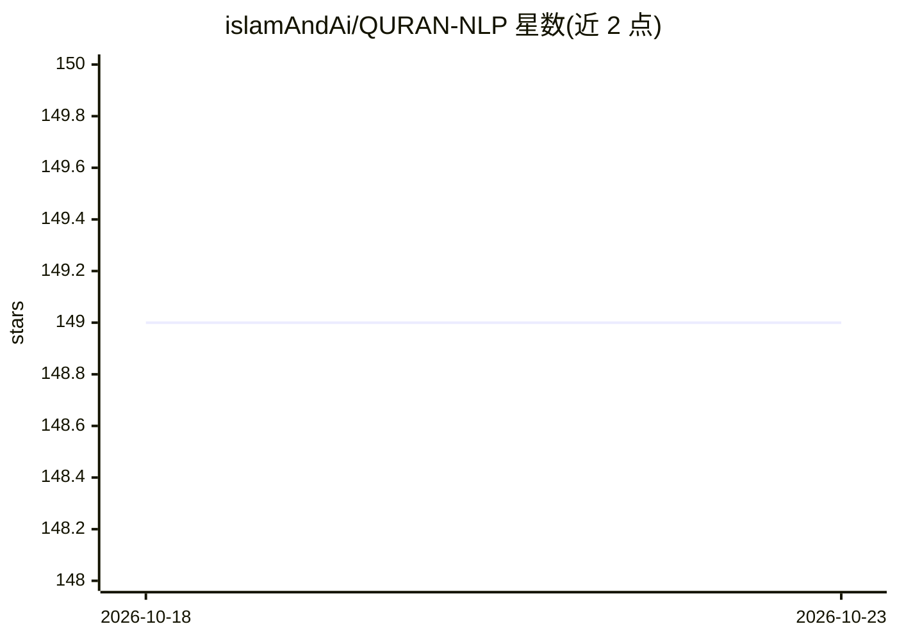

# islamAndAi/QURAN-NLP

⭐ 149 · Jupyter Notebook · Apache-2.0 · 推送 2026-09-06 · [GitHub](https://github.com/islamAndAi/QURAN-NLP) · [官网](https://www.kaggle.com/datasets/alizahidraja/quran-nlp) · 组织维护

**面向《古兰经》与圣训的 NLP 数据集与 Python 工具包**

开源数据集加零依赖 Python 包：整合 Uthmani 阿拉伯文经文（6,236 节）、12.8 万条词法语料、9 个英文译本、4 部英译注解、70 余万条圣训及 24,028 名传述人谱系图，提供 BM25、归一化词法与多语言向量三种检索模式（英/阿语），另有形态学分析与 isnad 谱系数据。数据经 normalize/validate 脚本版本化管理，逐源标注对齐状态；部分译本保留原始版权，再分发需自查权限。

## 筛选速览

| 维度 | 判定 | 备注 |
|---|---|---|
| AI 角色 | `ai-knowledge` | 知识聚合/清单类 |
| 许可风险 | `permissive` | Apache-2.0 |
| 部署形态 | `library` | 以包/库形式分发 |
| 模型依赖 | — | README 未给出锁定关系 |
| 硬件要求 | — | 无带数字的原话,不猜 |
| 安装摩擦 | `low` | 无编译、无系统依赖或容器化 |
| 成熟度 | — | 结构信号不足 |

## 能力要点

- 整合经文、词法语料、译本、注解、圣训与传述人谱系的版本化数据集
- 零依赖 Python 包支持 BM25 / 词法 / 向量语义三种检索（英阿双语）
- 24,028 名传述人的师生谱系图供 isnad 分析
- 提供归一化与校验脚本，逐源标注对齐状态

## 适用场景

- 对古兰经文本做词法、词根与语义检索研究
- 加载某节经文的阿拉伯文、多译本与多注解对照
- 基于传述人谱系做圣训 isnad 分析

## 场景标签

`语义搜索` · 领域:知识与检索

## 证据(README 行号)

> L11: QURAN‑NLP is an open-source dataset and toolkit for doing machine learning and
> L14: translations and tafaseer, and hundreds of thousands of hadiths into one

## 星数曲线

2026-10-18 149 → 2026-10-23 149（+0）

---
*卡片 v1 · prompt 1.4 · 生成 2026-10-22 · 置信度 mid · 依据 README sha `dff8a1a28e66` · [字段定义](../../DATASET.md)*
