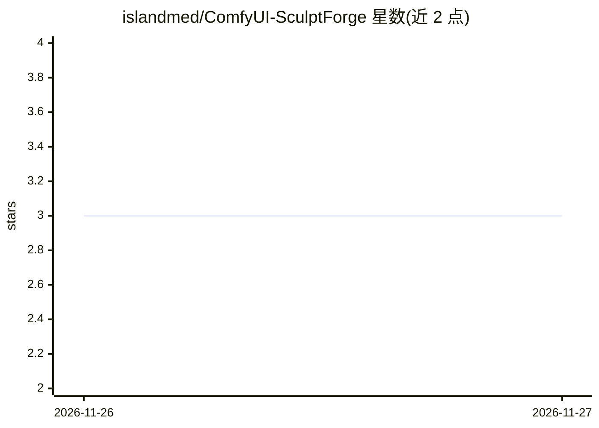

# islandmed/ComfyUI-SculptForge

⭐ 3 · Python · GPL-3.0 · 推送 2026-10-22 · [GitHub](https://github.com/islandmed/ComfyUI-SculptForge) · [官网](https://islandmed.github.io/SculptForge/) · 个人维护

**ComfyUI 节点包：把生成的 3D 网格重建成可雕刻/游戏可用资产并多格式导出**

一组 ComfyUI 自定义节点，调用本地 `sculptforge-cli` 命令行工具（无新增 Python 依赖），对工作流产出的网格（如 Hunyuan3D、TRELLIS 生成的模型或草图膨胀网格）执行体素重网格、减面、细分与 LOD 链生成，并导出 GLB/FBX/USD/USDA/USDZ/OBJ/STL/PLY 等格式；节点间以 SculptForge 项目格式在临时目录传递网格，保留 polygroup、polypaint 与雕刻层。可通过 ComfyUI-Manager 或 git clone 安装，桌面端 SculptForge 应用可从 Releases 下载或源码构建。

## 筛选速览

| 维度 | 判定 | 备注 |
|---|---|---|
| AI 角色 | `ai-enhanced` | 去掉 AI 部分产品仍成立 |
| 许可风险 | `viral` | GPL-3.0 |
| 部署形态 | `desktop` | 安装包/桌面程序 |
| 模型依赖 | — | README 未给出锁定关系 |
| 硬件要求 | — | 无带数字的原话,不猜 |
| 安装摩擦 | `low` | 无编译、无系统依赖或容器化 |
| 成熟度 | — | 结构信号不足 |

## 能力要点

- Voxel Remesh 将破损或自交的 AI 生成网格重建为水密雕刻面
- Decimate/Subdivide/LOD Chain 面向游戏预算的网格处理链
- Inflate Image 在 CPU 上将草图/剪影秒级膨胀为 3D 基础网格
- 导出 GLB/FBX/USD 等格式，覆盖游戏引擎、VFX、AR 与 3D 打印用途

## 适用场景

- 把 Hunyuan3D 图生 3D 的结果整备为游戏引擎可用的 LOD 资产
- 草图或剪影快速膨胀成基础网格后再雕刻
- 将 3D 输出转为 USDZ 用于 Apple AR 或 STL 用于 3D 打印

## 场景标签

 · 领域:3D 内容创作工具

## 证据(README 行号)

> L3: SculptForge nodes for ComfyUI:
> L11: - **Inflate Image** turns a sketch or silhouette into a 3D base mesh in a second on the CPU, no GPU or model downlo
> L16: The nodes run the free `sculptforge-cli` command-line tool, so they add no Python dependencies to ComfyUI.

## 星数曲线

2026-11-26 3 → 2026-11-27 3（+0）

---
*卡片 v1 · prompt 1.4 · 生成 2026-11-26 · 置信度 high · 依据 README sha `1bb9c995f7ba` · [字段定义](../../DATASET.md)*
