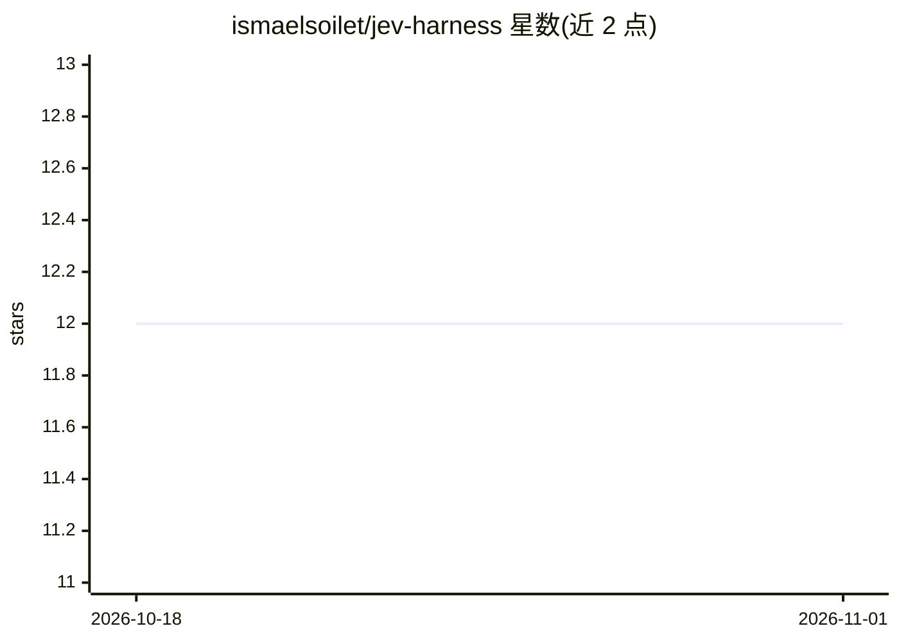

# ismaelsoilet/jev-harness

⭐ 12 · Python · MIT · 推送 2026-10-15 · [GitHub](https://github.com/ismaelsoilet/jev-harness) · [官网](https://pypi.org/project/jev-harness/) · 个人维护 · 中文 README

**AI 编码代理的决策闸门层：离线分流测试失败、省 token、断死循环**

面向 AI 编码代理（Claude Code、Cursor、OpenCode 等）的确定性决策层，以 CLI、MCP 服务器、git/CI 钩子与三种运行时 SDK（Python/TypeScript/Rust）提供五类语义闸门：测试失败分诊、死循环中断、完成否决、推理力度治理与模型路由。机制上先用零 token 的本地确定性启发式（<500µs）识别缺依赖、瞬时网络错误等琐碎情况，仅将模糊案例升级给 System One 微决策模型或前沿模型。本地确定性模式无需 API key，Python/TS 核心零外部依赖。

## 筛选速览

| 维度 | 判定 | 备注 |
|---|---|---|
| AI 角色 | `ai-ecosystem` | LLM/agent 周边工具 |
| 许可风险 | `permissive` | MIT |
| 部署形态 | `library` | 以包/库形式分发 |
| 模型依赖 | — | README 未给出锁定关系 |
| 硬件要求 | — | 无带数字的原话,不猜 |
| 安装摩擦 | `low` | 无编译、无系统依赖或容器化 |
| 成熟度 | `idea` | |

## 能力要点

- 确定性本地分诊缺依赖/瞬时错误，0 LLM token、<500µs
- doom loop 循环 3 次以上触发 abort gate（exit 1）
- Python/TS/Rust 三运行时语义对等，含 MCP server 与 git/CI 钩子
- 凭据脱敏、聚焦切片（≤15 行）、审计回执与 160 例校准回放

## 适用场景

- 让编码代理遇到测试失败时不再把 500 行 traceback 灌给昂贵模型
- 在 CI 中对失败步骤做离线分类并给出下一步确定性动作
- 为 Cursor/Claude Desktop 等挂载 MCP 决策闸门

## 场景标签

 · 领域:AI 开发者工具/代理基础设施

## 证据(README 行号)

> L26: > **What it is:** a deterministic-first **System 1.5 decision layer** for the code-quality loop — test-failure tria
> L77: - 🔌 **Universal MCP Server:** Exposes Jev decision tools over stdio (`jev-mcp`) for Cursor, Claude Desktop, Antigra

## 星数曲线

2026-10-18 12 → 2026-11-01 12（+0）

---
*卡片 v1 · prompt 1.4 · 生成 2026-11-01 · 置信度 high · 依据 README sha `440bda34fe48` · [字段定义](../../DATASET.md)*
