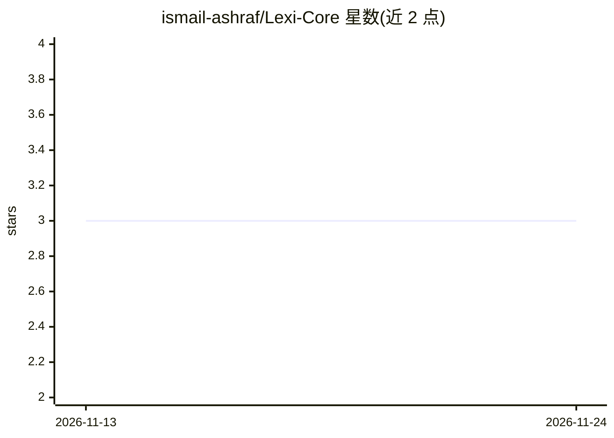

# ismail-ashraf/Lexi-Core

⭐ 3 · Python · 推送 2026-10-31 · [GitHub](https://github.com/ismail-ashraf/Lexi-Core) · 个人维护

**全栈文档智能系统：解析文档、语义检索并以 RAG 回答问题**

LexiCore 是全栈文档智能系统：前端上传文档后，经 FastAPI 分发任务至 Celery/Redis 异步队列，执行文档解析、GLiNER（ONNX 推理）实体抽取与 BERT 文本理解，生成嵌入并存入 ChromaDB；用户提问时按语义相似度检索文档块（支持文档级过滤），将上下文交给 Groq 托管的 LLM 生成带来源引用的回答。依赖 PostgreSQL、Redis、uv、Node.js 与 Groq API Key，各组件以独立进程运行。

## 筛选速览

| 维度 | 判定 | 备注 |
|---|---|---|
| AI 角色 | `ai-native` | 本体是模型或模型工具 |
| 许可风险 | `none` | — |
| 部署形态 | `library` | 以包/库形式分发 |
| 模型依赖 | locked-api |  |
| 硬件要求 | — | 无带数字的原话,不猜 |
| 安装摩擦 | `low` | 无编译、无系统依赖或容器化 |
| 成熟度 | — | 结构信号不足 |

## 能力要点

- NER（GLiNER+ONNX）与 BERT 文档理解多层处理
- RAG 流水线：分块、嵌入、ChromaDB 向量索引、语义检索
- Celery+Redis 异步后台处理，API 与计算分离
- 交互式前端与 Swagger API 文档

## 适用场景

- 上传文档后用自然语言提问并获得带来源的回答
- 从非结构化文档中抽取实体与结构化信息
- 对特定文档做受限制的语义检索问答

## 场景标签

`文档解析` `RAG` `文档问答` · 领域:知识与检索

## 证据(README 行号)

> L5: LexiCore is a full-stack AI-powered document intelligence system designed to transform unstructured documents into s
> L183: 7. **Answer Generation:** Send the question and retrieved context to a Groq-hosted LLM.
> L137: - **Retrieval-Augmented Generation (RAG):** Generate answers using retrieved document context.

## 星数曲线

2026-11-13 3 → 2026-11-24 3（+0）

---
*卡片 v1 · prompt 1.4 · 生成 2026-11-21 · 置信度 high · 依据 README sha `b788b76abefb` · [字段定义](../../DATASET.md)*
