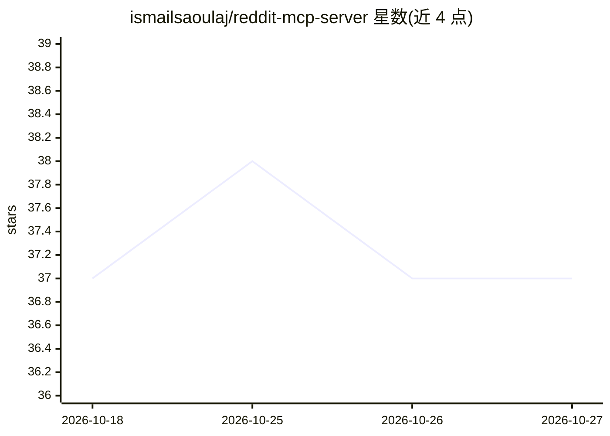

# ismailsaoulaj/reddit-mcp-server

⭐ 37 · Python · MIT · 推送 2026-08-24 · [GitHub](https://github.com/ismailsaoulaj/reddit-mcp-server) · 个人维护

**让 AI 助手实时检索与分析 Reddit 讨论的 MCP 服务器**

基于 Model Context Protocol 的 Reddit 数据接入服务器，为 Claude、Cursor、Open WebUI 等 AI 客户端提供 5 个结构化工具：DuckDuckGo 广域搜索、讨论搜索、社区观点提取、细分趋势追踪和保存帖读取。核心机制是零配置多级回退引擎（官方 OAuth→Session Cookie→浏览器模拟 JSON→Arctic Shift→DDG），无需 API key 即可运行；附带令牌桶限速、并发信号量、指数退避与 LLM 噪音过滤（剔除 AutoModerator/机器人评论）。支持 STDIO 本地运行与 Docker HTTP 微服务两种方式；需 Python 3.11+，Reddit 凭据为可选项。

## 筛选速览

| 维度 | 判定 | 备注 |
|---|---|---|
| AI 角色 | `ai-ecosystem` | LLM/agent 周边工具 |
| 许可风险 | `permissive` | MIT |
| 部署形态 | `self-host` | docker 或自建部署 |
| 模型依赖 | — | README 未给出锁定关系 |
| 硬件要求 | — | 无带数字的原话,不猜 |
| 安装摩擦 | `low` | 无编译、无系统依赖或容器化 |
| 成熟度 | — | 结构信号不足 |

## 能力要点

- 零配置多级回退引擎，无 Reddit API key 也可运行
- 令牌桶限速、并发信号量与 singleflight 防 WAF 403/IP 封禁
- LLM 噪音过滤：进入模型前剔除 AutoModerator、机器人与低信号评论
- STDIO 本地 CLI 与 Docker HTTP 微服务（端口 8000）双运行模式

## 适用场景

- 让 Claude/Cursor 在对话中直接搜索和读取 Reddit 讨论
- 提取某社区对产品或话题的真实评价与情绪
- 追踪细分领域的实时热帖与上升帖以发现痛点
- 以 Docker 微服务形式为 Open WebUI/LibreChat/n8n 提供 Reddit 工具

## 场景标签

`网页抓取` `语义搜索` · 领域:效率与自动化

## 证据(README 行号)

> L11: **Reddit MCP Server** is an open-source Model Context Protocol (MCP) server that connects AI assistants (Claude, Cu
> L37: - 🌐 **STDIO & SSE Transport:** Runs as a local CLI tool for Claude/Cursor or as a Docker microservice on port `8000

## 星数曲线

2026-10-18 37 → 2026-10-27 37（+0）

---
*卡片 v1 · prompt 1.4 · 生成 2026-10-25 · 置信度 mid · 依据 README sha `37639e1789ed` · [字段定义](../../DATASET.md)*
