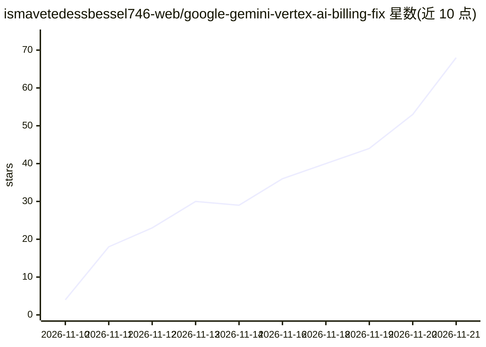

# ismavetedessbessel746-web/google-gemini-vertex-ai-billing-fix

⭐ 68 · 推送 2026-11-10 · [GitHub](https://github.com/ismavetedessbessel746-web/google-gemini-vertex-ai-billing-fix) · [官网](https://app.coregold.io/signup?invite_code=ADvlj9b) · 个人维护 · 中文 README

**推广 CoreGold 虚拟卡绑定 GCP 结算账号的图文指南**

仓库正文为一份营销性质的图文教程，声称国内信用卡绑定 Google Cloud 结算账号时常遇 OR_CCCHS_01 / OR_BACR2_34 拒付报错，并给出用 CoreGold 商业虚拟信用卡（VCC）完成绑卡的步骤：USDT 充值、开卡、在 Google Cloud Console 添加付款方式。文中还包含个人信用卡与该 VCC 的对比表格。仓库不提供任何可安装或运行的软件，README 末尾附有推广链接与一串哈希字符串。

## 筛选速览

| 维度 | 判定 | 备注 |
|---|---|---|
| AI 角色 | `ai-knowledge` | 知识聚合/清单类 |
| 许可风险 | `none` | — |
| 部署形态 | `None` |  |
| 模型依赖 | — | README 未给出锁定关系 |
| 硬件要求 | — | 无带数字的原话,不猜 |
| 安装摩擦 | `low` | 无编译、无系统依赖或容器化 |
| 成熟度 | — | 结构信号不足 |

## 能力要点

- 纯文档内容，无代码、无安装或运行方式
- 给出三步绑卡流程：USDT 充值→开卡→GCP 添加付款方式
- 含实体信用卡与 CoreGold VCC 的对比表格
- 全文围绕 CoreGold 商业虚拟卡服务展开并附注册链接

## 适用场景

- 了解其声称的 GCP 绑卡拒付报错代码背景
- 查看 CoreGold VCC 的开卡与绑卡操作步骤描述

## 场景标签

 · 领域:支付/云服务计费（推广内容）

## 证据(README 行号)

> L2: ⚡ 2026 实战指南：手把手教你用 CoreGold 商业 VCC 搞定 Google Cloud / Gemini API 绑卡
> L6: 更具破坏性的是，云端多模态 API 普遍采用弹性按量划扣模式。如果直接绑定国内无硬限额的实体信用卡，一旦线上并发失控、自动化解析脚本陷入死循环，次月账单可能会在无声无息中产生数千美元的透支；而找代充又面临组织账号因黑产料卡连坐被封的
> L8: 👉 **立即进入 CoreGold 官方开卡控制台**

## 星数曲线

2026-11-10 4 → 2026-11-21 68（+64）

---
*卡片 v1 · prompt 1.4 · 生成 2026-11-18 · 置信度 high · 依据 README sha `644b9d9ad6fc` · [字段定义](../../DATASET.md)*
