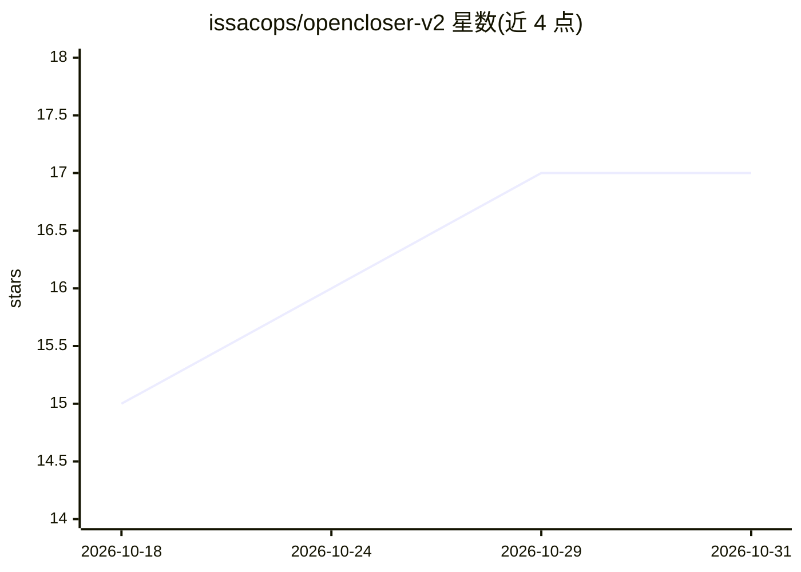

# issacops/opencloser-v2

⭐ 17 · TypeScript · MIT · 推送 2026-10-02 · [GitHub](https://github.com/issacops/opencloser-v2) · [官网](https://issacops.github.io/opencloser-v2/) · 组织维护

**本地桌面版开源 AI 销售团队：AI 冷呼、找客与教练**

基于 Tauri/React/Rust 的桌面端开源 AI 销售（SDR）平台，在本地运行一组 AI 角色：策略师生成 ICP（SPIN/Challenger 框架）、研究员自动寻客评分、语音 Caller 通过 Gemini/OpenAI Realtime/ElevenLabs 或本地 Ollama 驱动实时通话（内置 Twilio 线路或虚拟音频桥接）、教练做异议对练、经理做通话分析与跟进邮件。SQLite 本地存储，无 API key 可用 demo 模式，配置 Ollama 后可完全离线。面向独立创始人、初创团队与销售团队。

## 筛选速览

| 维度 | 判定 | 备注 |
|---|---|---|
| AI 角色 | `ai-native` | 本体是模型或模型工具 |
| 许可风险 | `permissive` | MIT |
| 部署形态 | `desktop` | 安装包/桌面程序 |
| 模型依赖 | local-ok | 支持本地模型 |
| 硬件要求 | — | 无带数字的原话,不猜 |
| 安装摩擦 | `low` | 无编译、无系统依赖或容器化 |
| 成熟度 | — | 结构信号不足 |

## 能力要点

- 多角色 AI 销售团队：策略/寻客/语音外呼/教练/分析
- 语音引擎可选 Gemini、OpenAI Realtime、ElevenLabs 或本地 Ollama，配置 Ollama 后可完全离线
- 内置 Twilio 电话线路与 cloudflared 隧道，也支持虚拟音频桥接 VoIP 应用
- 无 API key 即可用 demo 模式评估全部功能

## 适用场景

- 没有销售团队的独立创始人用 AI 外呼与找客
- 初创团队从第一天搭建带 AI 执行追踪的 Kanban CRM 销售流程
- 在意数据隐私、不能把客户数据送到 SaaS 的团队本地运行销售 AI
- 销售用 3 难度异议对练和通话复盘持续训练

## 场景标签

`语音 Agent` `网页抓取` · 领域:效率与自动化

## 证据(README 行号)

> L44: OpenCloser is an **open-source AI sales development platform** that runs entirely on your desktop. It gives you an 
> L76: Real-time AI voice agent powered by Google Gemini (also supports OpenAI Realtime and ElevenLabs ConvAI). **Built-in

## 星数曲线

2026-10-18 15 → 2026-10-31 17（+2）

---
*卡片 v1 · prompt 1.4 · 生成 2026-10-29 · 置信度 high · 依据 README sha `b27ba78cf175` · [字段定义](../../DATASET.md)*
