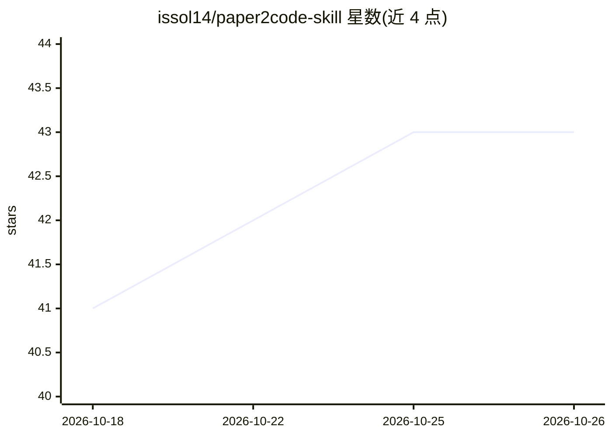

# issol14/paper2code-skill

⭐ 43 · MIT · 推送 2026-01-08 · [GitHub](https://github.com/issol14/paper2code-skill) · 个人维护 · 中文 README

**把研究论文转为可执行代码的 Claude Code 技能（免额外 API 费用）**

作为 Claude Code 的 Agent Skill，将 ML/DL 研究论文（PDF/arXiv）系统化转换为可运行代码：采用 4+2 阶段流水线（算法抽取→概念分析→代码规划→实现，外加参考代码搜索与记忆管理），以 YAML 中间表示沉淀知识，各阶段内置自检机制，支持长论文分节处理与断点恢复。运行依赖 Claude 订阅，PDF 处理可选安装 pdftotext。安装方式为 git clone 后复制到 Claude skills 目录。

## 筛选速览

| 维度 | 判定 | 备注 |
|---|---|---|
| AI 角色 | `ai-ecosystem` | LLM/agent 周边工具 |
| 许可风险 | `permissive` | MIT |
| 部署形态 | `None` |  |
| 模型依赖 | locked-api |  |
| 硬件要求 | — | 无带数字的原话,不猜 |
| 安装摩擦 | `low` | 无编译、无系统依赖或容器化 |
| 成熟度 | — | 结构信号不足 |

## 能力要点

- 4+2 阶段流水线：算法抽取→概念分析→代码规划→实现
- 结构化 YAML 中间表示与各阶段自检机制
- 参考代码搜索与长论文记忆管理（分节分析、可恢复检查点）
- 复用既有 Claude 订阅，无额外 API 成本

## 适用场景

- 拿到 arXiv 论文后让 Claude Code 直接产出可复现代码
- 只实现论文中的特定算法（如 Self-Attention）
- 论文实现与原文有出入时，通过 YAML 中间文件核对算法抽取结果

## 场景标签

`编码 Agent` · 领域:编码与开发

## 证据(README 行号)

> L19: **Paper2Code** is a Claude Code Skill that systematically converts research papers (PDF/arXiv) into fully functiona
> L23: - **4+2 Phase Pipeline**: Algorithm Extraction → Concept Analysis → Code Planning → Implementation (+ Reference Sea
> L211: - **Claude Code** with Claude subscription

## 星数曲线

2026-10-18 41 → 2026-10-26 43（+2）

---
*卡片 v1 · prompt 1.4 · 生成 2026-10-25 · 置信度 high · 依据 README sha `e06193448c18` · [字段定义](../../DATASET.md)*
